# src\Abstractions\Abstractions.csproj

[← Back to the assessment index](../../assessment.md)

## Project Info

- **Current Target Framework:** net10.0
- **Proposed Target Framework:** net11.0
- **SDK-style**: True
- **Project Kind:** ClassLibrary
- **Dependencies**: 0
- **Dependants**: 16
- **Number of Files**: 59
- **Number of Files with Incidents**: 1
- **Lines of Code**: 2107
- **Estimated LOC to modify**: 0+ (at least 0.0% of the project)

## Related Projects

**Depended on by (16)** — projects that reference this one:

- [Q:\src\copilot-worktrees\azure-functions-core-tools\fabiocav-fuzzy-robot\src\Func\Func.csproj](../projects/Func.md)
- [Q:\src\copilot-worktrees\azure-functions-core-tools\fabiocav-fuzzy-robot\src\Workloads\Stacks\DotNet\Workloads.DotNet.csproj](../projects/Workloads.DotNet.md)
- [Q:\src\copilot-worktrees\azure-functions-core-tools\fabiocav-fuzzy-robot\src\Workloads\Stacks\Go\Workloads.Go.csproj](../projects/Workloads.Go.md)
- [Q:\src\copilot-worktrees\azure-functions-core-tools\fabiocav-fuzzy-robot\src\Workloads\Stacks\Java\Workloads.Java.csproj](../projects/Workloads.Java.md)
- [Q:\src\copilot-worktrees\azure-functions-core-tools\fabiocav-fuzzy-robot\src\Workloads\Stacks\Node\Workloads.Node.csproj](../projects/Workloads.Node.md)
- [Q:\src\copilot-worktrees\azure-functions-core-tools\fabiocav-fuzzy-robot\src\Workloads\Stacks\PowerShell\Workloads.PowerShell.csproj](../projects/Workloads.PowerShell.md)
- [Q:\src\copilot-worktrees\azure-functions-core-tools\fabiocav-fuzzy-robot\src\Workloads\Stacks\Python\Workloads.Python.csproj](../projects/Workloads.Python.md)
- [Q:\src\copilot-worktrees\azure-functions-core-tools\fabiocav-fuzzy-robot\test\Fixtures\Workloads.Tests.Fixtures.Default\Workloads.Tests.Fixtures.Default.csproj](../projects/Workloads.Tests.Fixtures.Default.md)
- [Q:\src\copilot-worktrees\azure-functions-core-tools\fabiocav-fuzzy-robot\test\Fixtures\Workloads.Tests.Fixtures.Sdk\Workloads.Tests.Fixtures.Sdk.csproj](../projects/Workloads.Tests.Fixtures.Sdk.md)
- [Q:\src\copilot-worktrees\azure-functions-core-tools\fabiocav-fuzzy-robot\test\Fixtures\Workloads.Tests.Fixtures.WithCommand\Workloads.Tests.Fixtures.WithCommand.csproj](../projects/Workloads.Tests.Fixtures.WithCommand.md)
- [Q:\src\copilot-worktrees\azure-functions-core-tools\fabiocav-fuzzy-robot\test\Workloads\Stacks\DotNet.Tests\Workloads.DotNet.Tests.csproj](../projects/Workloads.DotNet.Tests.md)
- [Q:\src\copilot-worktrees\azure-functions-core-tools\fabiocav-fuzzy-robot\test\Workloads\Stacks\Go.Tests\Workloads.Go.Tests.csproj](../projects/Workloads.Go.Tests.md)
- [Q:\src\copilot-worktrees\azure-functions-core-tools\fabiocav-fuzzy-robot\test\Workloads\Stacks\Java.Tests\Workloads.Java.Tests.csproj](../projects/Workloads.Java.Tests.md)
- [Q:\src\copilot-worktrees\azure-functions-core-tools\fabiocav-fuzzy-robot\test\Workloads\Stacks\Node.Tests\Workloads.Node.Tests.csproj](../projects/Workloads.Node.Tests.md)
- [Q:\src\copilot-worktrees\azure-functions-core-tools\fabiocav-fuzzy-robot\test\Workloads\Stacks\PowerShell.Tests\Workloads.PowerShell.Tests.csproj](../projects/Workloads.PowerShell.Tests.md)
- [Q:\src\copilot-worktrees\azure-functions-core-tools\fabiocav-fuzzy-robot\test\Workloads\Stacks\Python.Tests\Workloads.Python.Tests.csproj](../projects/Workloads.Python.Tests.md)

## Dependency Graph

Legend:
📦 SDK-style project
⚙️ Classic project

```mermaid
flowchart TB
    subgraph upstream["Dependants (16)"]
        P2["<b>📦&nbsp;Func.csproj</b><br/><small>net10.0</small>"]
        P6["<b>📦&nbsp;Workloads.DotNet.csproj</b><br/><small>net10.0</small>"]
        P7["<b>📦&nbsp;Workloads.Go.csproj</b><br/><small>net10.0</small>"]
        P8["<b>📦&nbsp;Workloads.Java.csproj</b><br/><small>net10.0</small>"]
        P9["<b>📦&nbsp;Workloads.Node.csproj</b><br/><small>net10.0</small>"]
        P10["<b>📦&nbsp;Workloads.PowerShell.csproj</b><br/><small>net10.0</small>"]
        P11["<b>📦&nbsp;Workloads.Python.csproj</b><br/><small>net10.0</small>"]
        P17["<b>📦&nbsp;Workloads.Tests.Fixtures.Default.csproj</b><br/><small>net10.0</small>"]
        P18["<b>📦&nbsp;Workloads.Tests.Fixtures.Sdk.csproj</b><br/><small>net10.0</small>"]
        P19["<b>📦&nbsp;Workloads.Tests.Fixtures.WithCommand.csproj</b><br/><small>net10.0</small>"]
        P23["<b>📦&nbsp;Workloads.DotNet.Tests.csproj</b><br/><small>net10.0</small>"]
        P24["<b>📦&nbsp;Workloads.Go.Tests.csproj</b><br/><small>net10.0</small>"]
        P25["<b>📦&nbsp;Workloads.Java.Tests.csproj</b><br/><small>net10.0</small>"]
        P26["<b>📦&nbsp;Workloads.Node.Tests.csproj</b><br/><small>net10.0</small>"]
        P27["<b>📦&nbsp;Workloads.PowerShell.Tests.csproj</b><br/><small>net10.0</small>"]
        P28["<b>📦&nbsp;Workloads.Python.Tests.csproj</b><br/><small>net10.0</small>"]
        click P2 "../projects/Func.md"
        click P6 "../projects/Workloads.DotNet.md"
        click P7 "../projects/Workloads.Go.md"
        click P8 "../projects/Workloads.Java.md"
        click P9 "../projects/Workloads.Node.md"
        click P10 "../projects/Workloads.PowerShell.md"
        click P11 "../projects/Workloads.Python.md"
        click P17 "../projects/Workloads.Tests.Fixtures.Default.md"
        click P18 "../projects/Workloads.Tests.Fixtures.Sdk.md"
        click P19 "../projects/Workloads.Tests.Fixtures.WithCommand.md"
        click P23 "../projects/Workloads.DotNet.Tests.md"
        click P24 "../projects/Workloads.Go.Tests.md"
        click P25 "../projects/Workloads.Java.Tests.md"
        click P26 "../projects/Workloads.Node.Tests.md"
        click P27 "../projects/Workloads.PowerShell.Tests.md"
        click P28 "../projects/Workloads.Python.Tests.md"
    end
    subgraph current["Abstractions.csproj"]
        MAIN["<b>📦&nbsp;Abstractions.csproj</b><br/><small>net10.0</small>"]
        click MAIN "../projects/Abstractions.md"
    end
    P2 --> MAIN
    P6 --> MAIN
    P7 --> MAIN
    P8 --> MAIN
    P9 --> MAIN
    P10 --> MAIN
    P11 --> MAIN
    P17 --> MAIN
    P18 --> MAIN
    P19 --> MAIN
    P23 --> MAIN
    P24 --> MAIN
    P25 --> MAIN
    P26 --> MAIN
    P27 --> MAIN
    P28 --> MAIN

```

## API Compatibility

| Category | Count | Impact |
| :--- | :---: | :--- |
| 🔴 Binary Incompatible | 0 | High - Require code changes |
| 🟡 Source Incompatible | 0 | Medium - Needs re-compilation and potential conflicting API error fixing |
| 🔵 Behavioral change | 0 | Low - Behavioral changes that may require testing at runtime |
| ✅ Compatible | 2299 |  |
| ***Total APIs Analyzed*** | ***2299*** |  |

## NuGet Package Issues

| Package | Current Version | Suggested Version | Severity | Issue |
| :--- | :---: | :---: | :---: | :--- |
| Microsoft.Extensions.DependencyInjection.Abstractions | 10.0.7 | 11.0.0 | 🟡 Potential | NuGet package upgrade is recommended |
| System.CommandLine | 2.0.6 | 3.0.0 | 🟡 Potential | NuGet package upgrade is recommended |

Every project affected by these packages, and the versions the repository settles on: [aggregate NuGet packages](../nuget/aggregate-packages.md).

