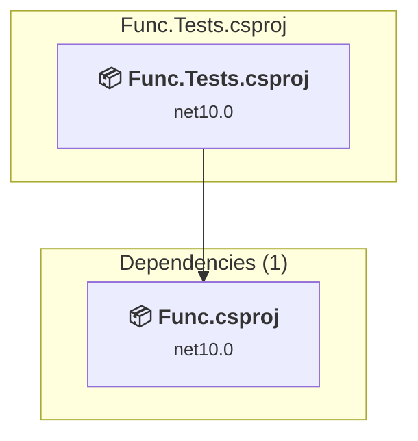

# test\Func.Tests\Func.Tests.csproj

[← Back to the assessment index](../../assessment.md)

## Project Info

- **Current Target Framework:** net10.0
- **Proposed Target Framework:** net11.0
- **SDK-style**: True
- **Project Kind:** ClassLibrary
- **Dependencies**: 1
- **Dependants**: 0
- **Number of Files**: 210
- **Number of Files with Incidents**: 43
- **Lines of Code**: 46362
- **Estimated LOC to modify**: 240+ (at least 0.5% of the project)

## Related Projects

**Depends on (1)** — projects this one references:

- [Q:\src\copilot-worktrees\azure-functions-core-tools\fabiocav-fuzzy-robot\src\Func\Func.csproj](../projects/Func.md)

## Dependency Graph

Legend:
📦 SDK-style project
⚙️ Classic project

## API Compatibility

| Category | Count | Impact |
| :--- | :---: | :--- |
| 🔴 Binary Incompatible | 0 | High - Require code changes |
| 🟡 Source Incompatible | 11 | Medium - Needs re-compilation and potential conflicting API error fixing |
| 🔵 Behavioral change | 229 | Low - Behavioral changes that may require testing at runtime |
| ✅ Compatible | 45892 |  |
| ***Total APIs Analyzed*** | ***46132*** |  |

