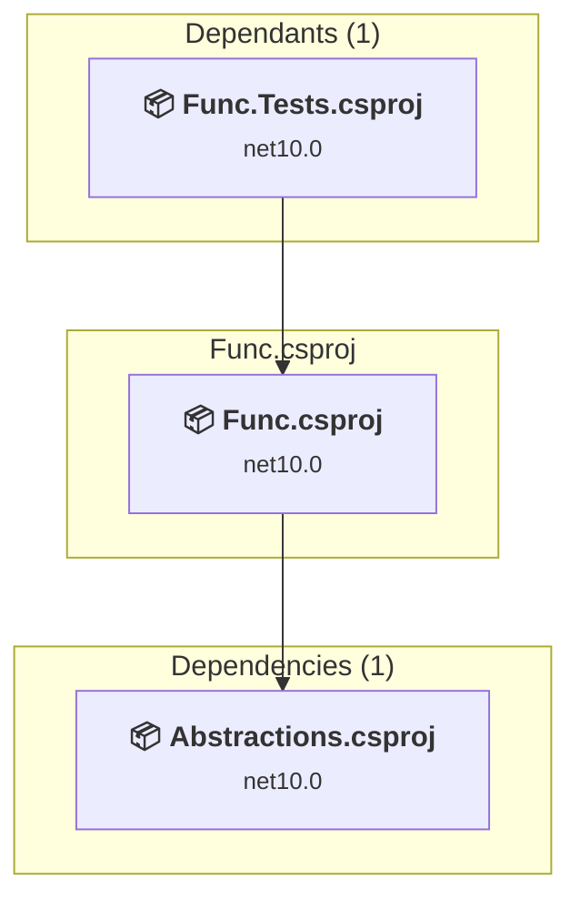

# src\Func\Func.csproj

[← Back to the assessment index](../../assessment.md)

## Project Info

- **Current Target Framework:** net10.0
- **Proposed Target Framework:** net11.0
- **SDK-style**: True
- **Project Kind:** DotNetCoreApp
- **Dependencies**: 1
- **Dependants**: 1
- **Number of Files**: 471
- **Number of Files with Incidents**: 40
- **Lines of Code**: 42528
- **Estimated LOC to modify**: 215+ (at least 0.5% of the project)

## Related Projects

**Depends on (1)** — projects this one references:

- [Q:\src\copilot-worktrees\azure-functions-core-tools\fabiocav-fuzzy-robot\src\Abstractions\Abstractions.csproj](../projects/Abstractions.md)

**Depended on by (1)** — projects that reference this one:

- [Q:\src\copilot-worktrees\azure-functions-core-tools\fabiocav-fuzzy-robot\test\Func.Tests\Func.Tests.csproj](../projects/Func.Tests.md)

## Dependency Graph

Legend:
📦 SDK-style project
⚙️ Classic project

## API Compatibility

| Category | Count | Impact |
| :--- | :---: | :--- |
| 🔴 Binary Incompatible | 0 | High - Require code changes |
| 🟡 Source Incompatible | 4 | Medium - Needs re-compilation and potential conflicting API error fixing |
| 🔵 Behavioral change | 211 | Low - Behavioral changes that may require testing at runtime |
| ✅ Compatible | 41483 |  |
| ***Total APIs Analyzed*** | ***41698*** |  |

## NuGet Package Issues

| Package | Current Version | Suggested Version | Severity | Issue |
| :--- | :---: | :---: | :---: | :--- |
| Microsoft.Extensions.FileSystemGlobbing | 10.0.0 | 11.0.0 | 🟡 Potential | NuGet package upgrade is recommended |
| Microsoft.Extensions.Hosting | 10.0.0 | 11.0.0 | 🟡 Potential | NuGet package upgrade is recommended |
| Microsoft.Extensions.Http | 10.0.0 | 11.0.0 | 🟡 Potential | NuGet package upgrade is recommended |
| Microsoft.Extensions.Options.DataAnnotations | 10.0.0 | 11.0.0 | 🟡 Potential | NuGet package upgrade is recommended |
| Microsoft.TemplateEngine.Abstractions | 10.0.301 | 11.0.100 | 🟡 Potential | NuGet package upgrade is recommended |
| Microsoft.TemplateEngine.Edge | 10.0.301 | 11.0.100 | 🟡 Potential | NuGet package upgrade is recommended |
| Microsoft.TemplateEngine.Orchestrator.RunnableProjects | 10.0.301 | 11.0.100 | 🟡 Potential | NuGet package upgrade is recommended |
| System.CommandLine | 2.0.6 | 3.0.0 | 🟡 Potential | NuGet package upgrade is recommended |

Every project affected by these packages, and the versions the repository settles on: [aggregate NuGet packages](../nuget/aggregate-packages.md).

