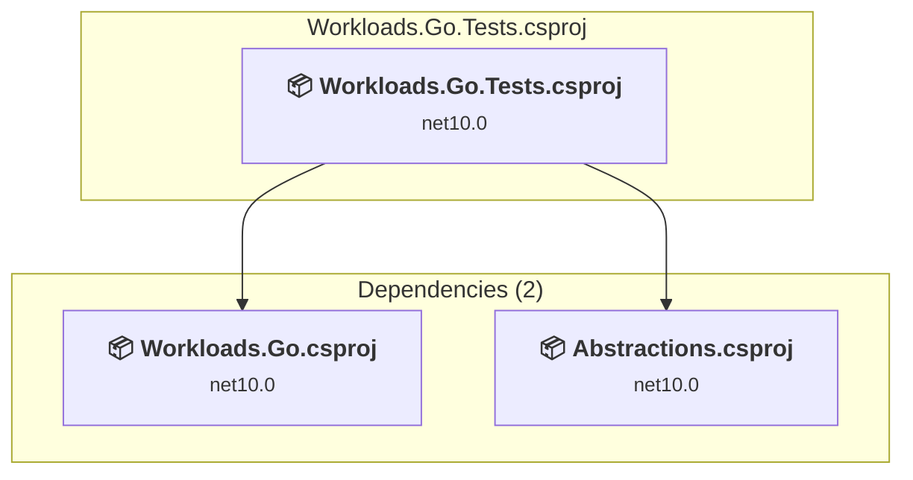

# test\Workloads\Stacks\Go.Tests\Workloads.Go.Tests.csproj

[← Back to the assessment index](../../assessment.md)

## Project Info

- **Current Target Framework:** net10.0
- **Proposed Target Framework:** net11.0
- **SDK-style**: True
- **Project Kind:** ClassLibrary
- **Dependencies**: 2
- **Dependants**: 0
- **Number of Files**: 5
- **Number of Files with Incidents**: 2
- **Lines of Code**: 705
- **Estimated LOC to modify**: 1+ (at least 0.1% of the project)

## Related Projects

**Depends on (2)** — projects this one references:

- [Q:\src\copilot-worktrees\azure-functions-core-tools\fabiocav-fuzzy-robot\src\Abstractions\Abstractions.csproj](../projects/Abstractions.md)
- [Q:\src\copilot-worktrees\azure-functions-core-tools\fabiocav-fuzzy-robot\src\Workloads\Stacks\Go\Workloads.Go.csproj](../projects/Workloads.Go.md)

## Dependency Graph

Legend:
📦 SDK-style project
⚙️ Classic project

## API Compatibility

| Category | Count | Impact |
| :--- | :---: | :--- |
| 🔴 Binary Incompatible | 0 | High - Require code changes |
| 🟡 Source Incompatible | 0 | Medium - Needs re-compilation and potential conflicting API error fixing |
| 🔵 Behavioral change | 1 | Low - Behavioral changes that may require testing at runtime |
| ✅ Compatible | 1162 |  |
| ***Total APIs Analyzed*** | ***1163*** |  |

## NuGet Package Issues

| Package | Current Version | Suggested Version | Severity | Issue |
| :--- | :---: | :---: | :---: | :--- |
| Microsoft.Extensions.DependencyInjection | 10.0.0 | 11.0.0 | 🟡 Potential | NuGet package upgrade is recommended |

Every project affected by these packages, and the versions the repository settles on: [aggregate NuGet packages](../nuget/aggregate-packages.md).

