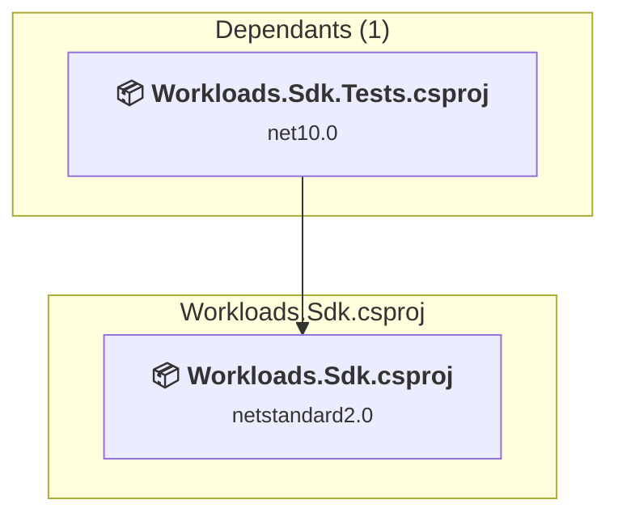

# src\Workloads\Sdk\Workloads.Sdk.csproj

[← Back to the assessment index](../../assessment.md)

## Project Info

- **Current Target Framework:** netstandard2.0✅
- **SDK-style**: True
- **Project Kind:** ClassLibrary
- **Dependencies**: 0
- **Dependants**: 1
- **Number of Files**: 5
- **Number of Files with Incidents**: 1
- **Lines of Code**: 419
- **Estimated LOC to modify**: 0+ (at least 0.0% of the project)

## Related Projects

**Depended on by (1)** — projects that reference this one:

- [Q:\src\copilot-worktrees\azure-functions-core-tools\fabiocav-fuzzy-robot\test\Workloads\Sdk.Tests\Workloads.Sdk.Tests.csproj](../projects/Workloads.Sdk.Tests.md)

## Dependency Graph

Legend:
📦 SDK-style project
⚙️ Classic project

## API Compatibility

| Category | Count | Impact |
| :--- | :---: | :--- |
| 🔴 Binary Incompatible | 0 | High - Require code changes |
| 🟡 Source Incompatible | 0 | Medium - Needs re-compilation and potential conflicting API error fixing |
| 🔵 Behavioral change | 0 | Low - Behavioral changes that may require testing at runtime |
| ✅ Compatible | 359 |  |
| ***Total APIs Analyzed*** | ***359*** |  |

## NuGet Package Issues

| Package | Current Version | Suggested Version | Severity | Issue |
| :--- | :---: | :---: | :---: | :--- |
| NETStandard.Library | 2.0.3 | — | 🔴 Mandatory | NuGet package functionality is included with framework reference |
| System.Reflection.MetadataLoadContext | 10.0.9 | 11.0.0 | 🟡 Potential | NuGet package upgrade is recommended |
| System.Text.Json | 10.0.9 | 11.0.0 | 🟡 Potential | NuGet package upgrade is recommended |

Every project affected by these packages, and the versions the repository settles on: [aggregate NuGet packages](../nuget/aggregate-packages.md).

