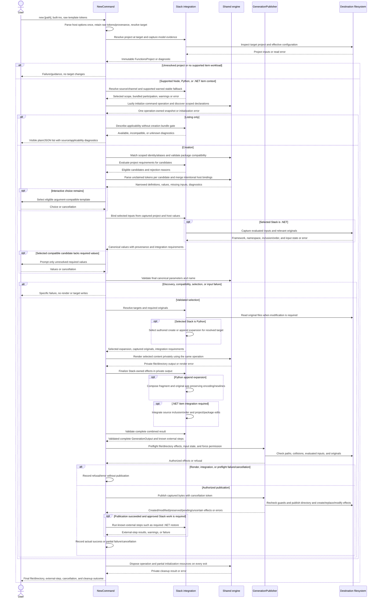

# CLI v5 Templates: Working Design

> **Historical design — superseded October 30, 2026.** This document preserves earlier architecture and behavioral research. Its proposed object model, physical engine extraction, template distribution, and legacy-retirement sequence are not the approved implementation direction. The redesign starts from [Fabio's object-model draft](CLI-v5-Templates-Object-Model-Fabio-Draft-2026-10-30.md); see the [Engine Redesign Execution Plan](CLI-v5-Templates-Engine-Redesign-Execution-Plan-2026-10-30.md) for current decisions and gates. Historical requirements and behavioral evidence still require explicit disposition. The research links below refer to the previous source workspace and are not available in this checkout.

**Status:** Historical reconciled proposal for independent Principal re-review and team discussion; superseded October 30, 2026; not approved for implementation or release.

**Date:** October 30, 2026

**Historical governing document:** [Architecture-reset charter](CLI-v5-Templates-Architecture-Reset-Clean.md).

> We will design the smallest implementation that preserves all supported behavior, makes `func init` and `func new` understandable end to end, and leaves room for Quickstart and future templates without implementing unnecessary infrastructure.

## A. Evidence, scope, and architecture in brief

Runtime means the Azure Functions Host/app runtime; Stack means the language stack; Generic Template refers to the templating-engine concept. CLI means command-line interface, UX means user experience, and cwd means current working directory.

### Authoritative inputs and inspected revisions

| Input | Availability, identity, and provenance |
|---|---|
| [Research A](../research/historical-design-reconciliation.md) | AVAILABLE; complete historical-to-current reconciliation, including R01-R30, D1-D12, historical citations, extraction, retirement, Python/Quickstart, simplification, open decisions, and limitations. Final status remains `RESEARCH A RECONCILIATION COMPLETE`. |
| [Research B](../research/v4-command-behavior-baseline.md) | AVAILABLE; complete September 16 source reconstruction, including six init stacks/eight combinations, command behavior, inventories, compatibility, consumers, and coverage gaps. Final status remains `RESEARCH B BLOCKED`: historical artifact attestation and runtime qualification are incomplete. |
| This repository | Reconciliation starts at `eae7be8a071ff4199702002a17898b9cf18c388e`, branch `templates/architecture-simplification`; repository identity, clean index/worktree and absence of an active Git operation verified before editing. The current Working Design, charter and both research reports were read completely. Earlier consolidation used `fdeb0200e2666cb071ea8cae77ded8084e120464`; its preceding design revision was `91dc9ad81c1878b78571fe5477e4959bad3a85e0`. |
| Independent Principal review | The supplied reconciliation instructions report **CHANGES RECOMMENDED BEFORE TEAM REVIEW** and summarize AR01-AR07. No complete report was attached or found as local read-only input. Those summaries are the authorized review instructions; this document does not claim inspection of the complete report. Dispositions appear in section M. |
| Historical baseline B | `9c41fa2e84d057d00c796332708e3f6e17472784`, September 16, 2026. Research B establishes a locally reconstructed **vnext** reference, not an authenticated shipped-v4 release or contemporaneous remote branch tip. |
| PR #5814 snapshot C | Head `1970fe07162d9ce2efdf79dd8c96f25e3e7317b3`, tree `d0c883dce107dd989b5817f84edfdf516d572cfd`; base `664830e683a35dffb9747bbfcac48929c591451c`. Earlier source inspection remains evidence for this proposal; local object availability and unchanged `src`, `test`, and `eng` relative to C were rechecked for this reconciliation. |

Research A's historical citation keys and exact revisions remain authoritative for historical intent. Its caveat about the original supplied design copies is preserved; committing the reports does not retrospectively authenticate those copies. No historical findings are rewritten here.

Evidence labels used below:

- **VERIFIED HISTORICAL REQUIREMENT (H):** documented intent in Research A, not proof of implementation.
- **VERIFIED SOURCE IMPLEMENTATION (S):** inspected implementation reported by Research B or explicitly identified C source.
- **EXISTING TEST ASSERTION (T):** inspected test expectation, not a passing execution.
- **PROPOSED DESIGN (P):** every architecture/UX choice in this document unless expressly a governing requirement.
- **INTENTIONAL BEHAVIOR CHANGE (BC):** proposed observable difference requiring team approval.
- **DEFERRED REQUIREMENT (DR):** proposed release-scope exclusion, not denial of historical intent.
- **MISSING ARTIFACT EVIDENCE (MA):** exact historical package/payload evidence is absent.
- **RUNTIME VALIDATION REQUIRED (RV):** no executed qualification is claimed.

References such as **A:R16**, **B:E**, and **C:Selection** mean Research A's requirement row, Research B's section, and the pinned PR source group respectively. H/S/T remain separate from P/BC/DR throughout.

### Smallest proposed architecture

1. Keep the existing public `InitCommand` and `NewCommand`, dependency-injection (DI) composition, interaction service, project resolution, and Stack integrations. Do not retain a second command graph.
2. Use one extracted, in-process Microsoft.TemplateEngine-based component behind a small public contract. It owns metadata discovery, selection support, parameter validation, and private rendering. It does not own prompts or interpret stack project files.
3. Keep one immutable `TemplateDefinition` per declaration. Reuse `FunctionsProject` for captured project context; do not introduce a parallel project-facts model.
4. Lazily initialize one disposable command-scoped engine operation with one declaration snapshot, reused for discovery, selection and rendering. Load selected content on demand. This is a proposed D2 revision, not an approved change to the charter's process-lifetime inventory recommendation.
5. Render to private output, then pass immutable file and explicit directory-create effects to one CLI-side `GenerationPublisher`. Stack code binds project-derived inputs, composes append/project edits and supplies configuration semantics. Existing Stack helpers run approved external steps separately; publication is neither another renderer nor a post-action executor.
6. Convert supported legacy content to the common format during content production, not through a permanent legacy domain-specific language (DSL) renderer. Preserve behavior and public IDs, not old wrapper classes.

These are recommendations, not approvals. Initial migration acceptance includes all six init stacks and the three established item-workload stacks. New lifecycle commands, dry-run UX, explicit init-template selection, full Quickstart workflows, and producer automation are proposed deferrals requiring scope approval. Offline **template availability** does not promise offline software development kit (SDK), npm, Go, worker, or extension-bundle availability.

## B. Requirements disposition

Every row is **P**, with the stated disposition proposed for the initial migration. "Preserve" is subject to the corrections in section C, not a promise to retain defects. Existing tests are coverage evidence only.

| ID | Actual baseline behavior (S) | Required initial-release behavior (P) | Disposition | Rationale | Evidence | Open decision |
|---|---|---|---|---|---|---|
| R01 | Init uses stack initializers; new uses V2/.NET wrappers; foundation not active. | One authoritative extracted renderer for retained content. | SIMPLIFY IMPLEMENTATION | Preserve operations, remove parallel engines. | A:R01; B:H | D6, D11, D12 |
| R02 | Embedded scaffolds, V2 DSL, and projected .NET content coexist. | Convert qualified assets to standard engine templates before cutover. | SUPERSEDE | No permanent DSL/projection rendering path. | A:R02; B:D,F,H | D4; exact missing payloads |
| R03 | Three separate hives; .NET item hive differs from FuncHome. | Isolated deterministic bundled location; no dependency on `dotnet new` user state. | SIMPLIFY IMPLEMENTATION | Replace mutable provisioning with local supplied content. | A:R03; B:H | D1; BC08 |
| R04 | Workloads supply content; .NET can provision on demand. | Discovery/generation do not acquire content or maintain a competing registry. | SIMPLIFY IMPLEMENTATION | Separate acquisition from use. | A:R04; B:H | Future lifecycle authority, D12 |
| R05 | No equivalent new template install/update/uninstall command established by B. | Retain workload access to supported content; defer new lifecycle commands. | DEFER | Historical requirement exists; not initial command scope. | A:R05; B:H | Team release-scope approval |
| R06 | Content workload layout/manifests affect availability. | Validate shipped package identity, version, format, and integrity; defer ownership routing. | SIMPLIFY IMPLEMENTATION | Keep trust checks without installer framework. | A:R06; B:H | D1, D4, D12 |
| R07 | New replacement protocol not established by B. | No mutable package replacement initially. | DEFER | Preserve future source/version authorization requirement. | A:R07 | Future update scope |
| R08 | No corresponding replacement transaction established by B. | Package updates deferred; later failed replacement must retain usable old content. | DEFER | Package safety differs from file publication. | A:R08 | D12 |
| R09 | Active wrappers differ from proposed session facade. | One lazy command operation and declaration snapshot through discovery and render. | SIMPLIFY IMPLEMENTATION | AR06 proposes revising D2; no demonstrated consumer needs a separate process cache. | A:R09; B:H | D2 revision requires approval; D6 |
| R10 | Context/configuration can be resolved at different stages. | One immutable operation context for selection, defaults, checks, and render. | PRESERVE | Preserve intended consistency, not ambient re-resolution. | A:R10; B:E | D7 |
| R11 | Legacy catalogs filter hidden entries; listing bypasses creation gate. | One inventory with metadata/diagnostics; listing still separate from creation permission. | SIMPLIFY IMPLEMENTATION | No duplicate context-bound catalogs. | A:R11; B:E,G | D4, D5 |
| R12 | New matches catalog IDs case-insensitively, not arbitrary display names. | Preserve those IDs/case rules; exact identity before declared aliases; ambiguity fails. | PRESERVE | Internal package coordinates are not public grammar. | A:R12; B:E | D3; new alias additions require approval |
| R13 | Approximate bundle checks; model/profile constraints incompletely enforced. | Check declared requirements before prompts; unknown/evaluation error is not compatible. | CORRECT INTENTIONALLY | Make rejection explicit; identify policy additions separately. | A:R13; B:G | BC03, BC07; D5 |
| R14 | CLI owns selection; absent choice fails noninteractively. | Reuse definition lists and candidate-specific diagnostics, not a graph hierarchy. | SIMPLIFY IMPLEMENTATION | Retain narrowing/ambiguity without duplicate objects. | A:R14; B:E | D3, D6 |
| R15 | Dynamic metadata has aliases/defaults/types; some collisions are skipped. | Preserve effective public aliases; reserve host option names while allowing explicit host-to-template bindings. | CORRECT INTENTIONALLY | AR05 distinguishes intentional canonical bindings from unrelated alias conflicts. | A:R15; B:E | BC02; D3, D4 |
| R16 | Best-effort cwd hydration; unmatched tokens can survive; .NET ignores overrides. | Parse raw tokens per eligible candidate at actual target; reject invalid explicit input. | CORRECT INTENTIONALLY | Preserve disambiguation; eliminate ignored input. | A:R16; B:E,F | BC02; alias-collision policy D3 |
| R17 | Template picker exists; required-value prompting not generally implemented. | Preserve picker; prompt only for unresolved required values; never repair invalid explicit input. | CORRECT INTENTIONALLY | Historical completion UX, explicitly new where absent. | A:R17; B:D,E | BC04; D3, D4 |
| R18 | New has positional directory, no upward search; Node/Python/.NET item workloads. | Keep positional directory and target/root distinction; no automatic upward search. | PRESERVE | Do not reinterpret a directory as template identity. | A:R18; B:E | Future upward discovery deferred |
| R19 | No public init/new dry-run option. | Use private preparation for safety; defer public dry-run/preview UX. | DEFER | Safety does not require another public mode. | A:R19; B:D,E | Team scope approval |
| R20 | Six behavioral initializers; five embed project files. | Move scaffolds into content; retain stack inspection, options, configuration and setup effects. | SIMPLIFY IMPLEMENTATION | Stack-specific semantics remain, duplicate renderers do not. | A:R20; B:C,D | D6, D7, D11 |
| R21 | Init selects stack then language; no project-template option. | Retain that journey and select the qualified stack/language project default. | PRESERVE | Explicit init-template UX deferred; do not freeze future topology. | A:R21; B:D | D9; historical template-intersection scope narrowed explicitly |
| R22 | Adoption/healing updates configuration without scaffolding. | Preserve those branches without inventory or rendering. | PRESERVE | No template dependency for metadata-only operations. | A:R22; B:D | D7, BC05 |
| R23 | CLI config precedes scaffolding; failed persistence may only warn. | CLI owns merged config and writes it after output, with failure reported. | CORRECT INTENTIONALLY | Do not claim successful initialization with unpersisted state. | A:R23; B:D | BC05; D8 |
| R24 | Legacy init directly writes CLI config. Later design requires trusted actions. | Use typed configuration intents, not a general post-action executor. | SUPERSEDE | CLI serialization plus resolved output roots is smaller. | A:R24; B:D; C:Integration | D8, D9 must approve replacement of later action contract |
| R25 | Force clears before some late checks; partial writes can succeed. | Preflight before force cleanup; explicit partial effects; no global rollback claim. | CORRECT INTENTIONALLY | Preserve explicit destructive permission, fix ordering/reporting. | A:R25; B:D,E | BC01, BC06; D8 |
| R26 | Full Quickstart behavior not established as baseline execution. | Ordinary project-template category may describe multiple heterogeneous roots; defer workflow. | DEFER | No special Quickstart renderer/type; preserve extension contract. | A:R26; B:L | D9; scope approval |
| R27 | New does not install missing workloads; .NET can install templates internally. | No hidden acquisition during discovery/rendering; actionable setup guidance. | CORRECT INTENTIONALLY | Deterministic local generation. | A:R27; B:E,H | BC08; D12 |
| R28 | Source packaging uses stack/repository-specific production inputs. | CLI consumes origin-independent local assets; selected-subfolder tooling deferred. | DEFER | Producer, not consumer, knows monorepo layout. | A:R28; B:H | D9 |
| R29 | Packaging downloads/filtering affect final inventory; artifacts missing. | Freeze/hash approved shipped assets and validate packages; defer broader promotion pipeline. | SIMPLIFY IMPLEMENTATION | Provenance gate now, automation later. | A:R29; B:F,H | D1, D11; MA |
| R30 | Separate historical search/supply/binding/action designs are not active command proof. | Keep ownership boundaries; defer unused search/providers/actions infrastructure. | DEFER | No speculative framework. | A:R30; B:L | D6, D9, D12 |

## C. Public UX and explicit behavior corrections

### Preserve the public grammar

```text
func init [path] [--stack|-s <stack>] [--language|-l <language>] [--name|-n <name>] [--force] [stack options]
func new [path] [--template|-t <id>] [--name|-n <name>] [--force] [--non-interactive] [--list|-l] [--output plain|json] [template options]
```

`[path]` remains the destination, defaulting to cwd. No positional template, new `--path`, `--language` for new, init `--template`, or public dry-run is introduced by this proposal. Historical proposals for those features receive explicit deferral, not claims of existing support.

Preserve canonical stack IDs and worker-runtime aliases, language aliases, shared option registration, and effective configuration precedence described in B:C-E. The legacy configuration key named runtime is translated at the stack boundary; documentation uses **runtime** only for the Azure Functions Host/app runtime. The historical Go alias `native` remains accepted as an alias, not a new component name.

### Intentional changes requiring approval

| ID | Baseline S | Proposed BC and required acceptance check |
|---|---|---|
| BC01 | Init creates/clears destination before all validation; `.git` files are deleted. | Resolve, validate and render before target mutations/force cleanup; protect `.git` files and directories. Decline/cancel before cleanup leaves destination unchanged. Preserve explicit force recovery from readable malformed CLI config and baseline confirmation behavior. Stricter destination/link restrictions or mandatory confirmation without input remain intentional changes for D8 approval. |
| BC02 | Cwd-based option hydration, ignored/unmatched inputs, dropped alias collisions, ineffective Node/.NET parameters. | Parse against actual target and each candidate; preserve raw occurrences and explicit-default provenance; reject unknown/conflicting/duplicate explicit inputs. Restore parameter-to-output fidelity for declared supported parameters. Never invent HTTP auth options absent from actual Node metadata. |
| BC03 | Approximate version ranges, ordinal .NET ordering, weak programming-model checks. | Use semantic versions and full declared range semantics; require stack-owned model evidence where content needs it. Invalid or missing mandatory evidence refuses creation rather than assuming compatibility. |
| BC04 | Required-value prompting generally absent. | After compatibility and candidate narrowing, prompt only for missing required values; explicit invalid input fails. Noninteractive creation never guesses a template; missing required values fail with usable syntax. |
| BC05 | CLI config precedes generation; some write failures merely warn. | Preflight config with output; persist merged config last, per file; report failure and actual generated effects if persistence fails. Preserve single-language omission and adoption's unresolved-language allowance. |
| BC06 | V2 skips collisions and can report partial success; append can duplicate functions. | Preflight all effects; a blocked generation fails before writes. Append is an explicit guarded modify, not a create collision or force requirement. Duplicate-function rejection is not assumed: characterize the baseline and leave any change open under D10. |
| BC07 | Listing bypasses creation gates; stable fallback warns; profile restrictions unused. | Preserve listing without creation-time bundle resolution and stable fallback with warning. Mark incompatibility/unknown state in list results. Do not newly enforce profile restrictions or change no-bundle HTTP policy without a separate approved policy decision. |
| BC08 | Unversioned .NET project provisioning and on-demand item installation can access package sources. | Supply pinned compatible content locally; no implicit install during render. Preserve explicit dependency/setup effects separately; template availability is offline, dependency restore may not be. |

BC02's ineffective parameters are not silently dropped or newly advertised: compare actual catalog declarations to output, repair intended declared inputs, retain working aliases, and reject undeclared inputs. B:F's Node HTTP has anonymous auth and no auth-level parameter. Exact Python/.NET historical contracts remain MA until artifacts are supplied.

Host-owned options belong to the CLI's template-engine host, not the Azure Functions Host. These options, including contributed Stack options, are parsed once by the public command. Stack integration explicitly maps resolved host values to canonical engine parameters, such as existing init `--target-framework/-tfm net10.0` to `Framework`. Carry whether the value was explicitly supplied (even if equal to the default), a host default, or project-derived; retain authored-default provenance separately. Candidate parsing consumes only unclaimed template tokens and merges these bindings without reparsing host options. Validate intentional mappings against each definition; reject unrelated aliases that claim reserved names and conflicting explicit assignments to the same canonical parameter. Do not reject an intentional host-to-template binding as an alias collision. This changes neither public syntax nor which command registers an option.

Defaults, setup warnings, and effective configuration are not silently normalized. Node npm and Go tidy remain default post-generation steps with skip flags. Their historical nonfatal failure behavior remains a visible setup warning, not full setup success. PowerShell dependency lookup remains best-effort with its warning/placeholder. Characterize .NET restore behavior before choosing its replacement setup ordering.

## D. Complete func init experience

1. Parse public options and contributed stack options, preserving aliases. Resolve an absolute destination and cancellation token without creating it.
2. Inspect target markers, filesystem safety and CLI configuration separately. A readable regular `.func/config.json` with invalid JSON or invalid configuration is replaceable state, not a fresh project: without force, diagnose it and explain recovery; with explicit `--force`, retain the regeneration path without trusting its values. Unreadable files, unsafe links, file/directory conflicts and unverifiable ancestry are not parse errors and cannot be bypassed by force.
3. Without force: refuse a complete initialized project; heal missing language in valid configuration by merging only the needed key; adopt an existing `host.json` project without scaffolding. Adoption uses explicit Stack or local-settings worker runtime, rejects known conflicts, and does not substitute the process environment signal. Inconclusive language may remain absent as in B:D. Adoption/healing bypass engine initialization.
4. For fresh generation or explicit force regeneration (including malformed CLI config), select installed Stack and language from valid invocation inputs and existing selection rules, not invalid config. One installed initializer/one language can resolve automatically; multiple Stacks/languages require selection or fail without input. `--language` alone does not select a Stack. Validate requested Stack/language and contributed options before any cleanup; unsupported/uninstalled choices receive setup guidance.
5. Lazily initialize one command-scoped engine operation and project declaration snapshot. Resolve the qualified default for that Stack/language; missing, corrupt, duplicate defaults fail explicitly. No hidden first-template choice. A future explicit ordinary project-template choice may precede Stack resolution for heterogeneous templates; not initial public UX.
6. Check engine/package and template/Stack compatibility and target policy. Build one immutable context using existing creation/project contracts. Stack integration binds parsed host options and resolved defaults to canonical parameters, preserving explicit/default provenance; do not refresh ambient values during execution.
7. Resolve name, supplied template values, authored defaults and unresolved required inputs. Reject invalid explicit values; prompt only where necessary. Complete canonical validation before rendering or destructive permission is exercised.
8. Reuse that engine operation to render selected content privately. Stack integration finalizes host/local settings, project-specific options and typed CLI configuration intents in private output. Include explicit empty directories such as Node's `src/functions`; parents implied by files need no authored directory effect. No target scaffolding or configuration writes yet.
9. Prepare one `GenerationOutput`; preflight all file/directory effects, configuration and the exact force cleanup set before mutation. Without force, preserve existing scaffold files under B:D's write-if-missing contract and report every skipped file; item collision policy is different. With force, preserve directory-clearing semantics and protect `.git` directories and worktree-pointer files, including necessary ancestors, without following their targets. Confirm cleanup when input is available; without input, explicit `--force` remains the baseline authorization. A stricter confirmation requirement is an unresolved behavior change, not an implicit safety correction.
10. Recheck cleanup authorization, target state and cancellation before deleting anything. Publish permitted directory/file effects, then CLI configuration (merged for adoption/healing, regenerated for force); run preserved Stack setup only after its prerequisite files exist. Report deleted, generated and preserved paths and external-step results separately. A fatal publication/configuration failure is nonzero with completed/pending/uncertain effects; cancellation reports whether mutation occurred. Dispose the operation and report private-workspace cleanup errors on every exit. D8 still requires approval and platform qualification.

### Six initialization stacks, eight language combinations

The target is common **content-backed** generation, not a claim that six package-backed project templates already exist.

| Stack / language | Baseline S and preserved visible outcome | Proposed common-engine migration / retained stack effects |
|---|---|---|
| .NET C# | Isolated project; `--target-framework/-tfm net10.0`; name/output; external project package. | Pin and qualify project content; retain framework validation and project setup. Exact historical package selection remains MA. |
| .NET F# | Same command options, distinct F# output. | Separate content case; verify `.fs` inclusion/order and function discovery, not just build success. |
| Node JavaScript | `src/functions/*.js`, package/host/local settings; bundles; npm by default. | Convert embedded scaffold to project content; preserve initially empty `src/functions`, Node v4, name, bundles/channel and `--skip-npm-install`. |
| Node TypeScript | TypeScript project, `tsconfig.json`, compiled `dist/src/functions/*.js`. | Separate project variant; preserve compiler/setup and output-entry behavior. |
| Python | Python v2 `function_app.py`, requirements, getting-started/settings; no pip/venv setup. | Project and item definitions share the engine; stack owns append interpretation and project configuration. |
| Go | Project files plus anonymous `hello` GET/POST; tidy by default. | Convert scaffold; preserve bundle flags, Go alias and `--skip-go-mod-tidy`; keep tool invocation outside renderer. |
| Java | Maven/Java 21 scaffold plus HTTP example; no Maven invocation during init. | Convert scaffold without inventing Maven setup or an item workload. |
| PowerShell | Interpreter option `--runtime-version` 7.4/7.6, managed-dependency option, optional requirements; no initial function. | Convert scaffold; preserve dependency settings/lookup behavior; no invented initial trigger. |

All non-.NET bundle options retain `--no-bundles` and `--bundles-channel/-c`, stable default, host JSON version `2.0`, and baseline bundle range unless an approved content change says otherwise. Host JSON schema version, bundle version, language programming model, and Host runtime are separate axes.

### Diagram A: func init end to end

All messages are proposed handoffs. `Stack integration` represents existing stack-owned services, not a new universal interface.

```mermaid
sequenceDiagram
    actor U as User
    participant C as InitCommand
    participant S as Stack integration
    participant E as Shared engine
    participant P as GenerationPublisher
    participant F as Destination filesystem
    U->>C: init [path], options
    C->>C: Parse host options once, retain provenance, resolve target and token
    C->>S: Inspect existing state and configuration
    S->>F: Read project markers and settings
    F-->>S: Readable state, malformed CLI config, or filesystem error
    S-->>C: Classify project and replaceable config separately from safety
    alt Unsafe/unreadable state, or invalid/complete config without force
        C-->>U: Actionable failure, no target changes
    else Valid adoption or language healing without force
        C->>S: Resolve Stack/language and merge configuration intent
        S-->>C: Validated configuration-only GenerationOutput
        C->>P: Preflight configuration and original-file precondition
        P->>F: Recheck state and publish permitted configuration
        P-->>C: Completion or failure effects
        C-->>U: Adopted/healed, or explicit failure/cancellation
    else Fresh generation or explicit force including malformed config
        C->>S: Resolve installed Stack/language and validate requested options
        opt Unresolved interactive choice
            C->>U: Prompt stack/language
            U-->>C: Choice or cancellation
        end
        S-->>C: Immutable creation context or diagnostic
        C->>E: Lazily initialize command operation and discover project declarations
        E-->>C: One operation-owned snapshot or initialization error
        C->>E: Resolve qualified default and check package compatibility
        C->>S: Check requirements and bind host options to canonical parameters
        S-->>C: Stack-bound values with explicit/default provenance or diagnostic
        C->>E: Validate supplied values and defaults
        opt Compatible candidate needs required input
            C->>U: Prompt only missing required values
            U-->>C: Values or cancellation
            C->>E: Validate completed values
        end
        alt Selection, compatibility, input, or cancellation failure
            C-->>U: Specific failure, no target changes
        else Validated request
            C->>E: Render privately using the same operation and selected content
            E-->>C: Captured file/directory effects or render failure
            C->>S: Finalize private output and configuration intents
            S-->>C: GenerationOutput plus known Stack setup requirements
            C->>P: Preflight files, directories, config, and protected cleanup set
            P->>F: Inspect target paths and original-file preconditions
            P-->>C: Permission requirements or refusal
            opt Valid force request and confirmation input available
                C->>U: Confirm explicit destination cleanup
                U-->>C: Accept, decline, or cancel
            end
            alt Render/finalization/preflight failed or user declined/cancelled
                C->>C: Record refusal/error without publication
            else Publication authorized
                C->>P: Publish with explicit force authorization and token
                P->>F: Recheck safety/token and apply cleanup and directory/file effects
                P->>F: Persist configuration last
                P-->>C: Deleted/created/preserved/pending/uncertain effects or errors
                opt Publication succeeded
                    C->>S: Run preserved dependency/setup steps
                    S-->>C: Setup results and warnings
                end
                C->>C: Record success, warnings, or partial failure/cancellation
            end
        end
        C->>E: Dispose operation and partial initialization resources on every exit
        E-->>C: Private cleanup result or error
        C-->>U: Final publication, setup, cancellation, and cleanup outcome
    end
```



## E. Complete func new experience

1. Parse built-ins once and retain raw template tokens, duplicate occurrences and explicit values equal to defaults. Resolve `[path]` independently of template identity; basic help needs no discovery. Selected-template help may lazily read its declarations.
2. Resolve a project at that target through existing factories; do not add upward search or require `.func/config.json` universally. Capture one `FunctionsProject`, effective stack/language and stack-owned model evidence. Do not hydrate options from unrelated cwd.
3. For Go, Java or PowerShell, return unsupported/missing-item-template guidance without target mutation. Their initialization examples do not establish positive item-generation support.
4. Resolve the effective template source/channel before identity matching: use the captured project/bundle context and existing compatible supplied-content selection, including warned stable fallback for missing preview/experimental content where supported. Bundled content supplies validated Stack/channel partitions, not a global override. Section G defines the selected scope; D1/D12 leave future installed-content precedence open.
5. Lazily initialize one command-scoped engine operation and item declaration snapshot for that scope. Listing returns visible definitions in plain/JSON form without creation's resolved-bundle gate; include source/fallback and applicability diagnostics rather than imply every listed item is executable. Preserve hidden-template exclusion unless the team approves an explicit-ID change.
6. For creation, check declared engine/package and project/template requirements before template-specific prompting. Retain the no-bundle HTTP gate until a separately approved policy changes it. Missing or unknown mandatory requirements produce useful rejection diagnostics. Match explicit catalog identity case-insensitively, then supported declared aliases within the selected source scope; never switch source/template after an explicit rejection.
7. Parse unclaimed template tokens **per remaining compatible candidate**, combining intentional host-to-template mappings rather than reparsing host options. Retain missing-value and rejection diagnostics. Interactive selection narrows eligible, argument-compatible choices; no match/ambiguity fails noninteractively, and a lone item is not selected without an explicit request.
8. Before required-value prompting and final canonical validation, Stack integration binds selected-template inputs from the captured project and parsed options. .NET captures evaluated framework, namespace and other required project values as described below. Resolve `--name`, authored default name, then ID fallback; validate types, choices, defaults, required values and name. Reject explicit invalid input rather than sanitizing it or replacing it with a prompt/default. Prompt only values still missing after Stack binding.
9. Resolve actual output targets and capture originals. Python chooses the authored create or append expansion, renders privately and composes a complete app modification. .NET renders privately, then integrates required source/project/package-reference edits. Validate the complete combined result, not just individual generated fragments. Reuse the same operation and selected content throughout.
10. Preflight every file/directory effect, collision and input precondition. A create target present without force refuses the operation (BC06); force permits guarded replacement, never compatibility bypass. Append needs no force solely because the app exists, but requires an unchanged captured original. Duplicate-function policy remains open under D10; structural validation does not silently introduce rejection.
11. Publish generic create/replace/modify and explicit directory-create effects with guarded originals. Run only known, approved Stack external steps after their prerequisite publication succeeds, and report them separately. New does not initialize the project, write CLI project configuration, install missing workloads or execute arbitrary package actions. Report cancellation, partial/uncertain effects, external-step failure and private cleanup failure distinctly from complete success; retain plain creation output and JSON listing behavior.

### Stack-owned item integration

**.NET input binding and effects (AR01/AR05).** Stack integration evaluates the selected .NET project, reusing existing facilities where sufficient, to capture the applicable target framework, effective namespace (including project defaults), source inclusion/order and other values required by the selected definition; raw project text alone is not evaluated context. Resolve multi-target or ambiguous inputs under Stack rules before final parameter validation; fail with a diagnostic when required values cannot be determined. Reuse `FunctionsProject` and operation-local Stack state, not a new project-facts envelope. Carry the evaluated values and their provenance into canonical engine parameters; do not reevaluate ambient project state halfway through rendering.

Capture originals for affected project files and the relevant evaluation inputs. After private rendering, Stack integration determines required deterministic edits: source/project inclusion, supported package references and related project changes. F# requires explicit `.fs` inclusion and correct compile order where the evaluated project requires them; merely creating a source file is insufficient. Prepare guarded modify effects for changed project files and validate them with generated sources as one result. Relevant project-input changes invalidate the prepared operation; they are not permission to publish against stale evaluation.

Deterministic file edits belong in combined preflight/publication. Required external work such as restore remains a known Stack operation invoked through existing process helpers after prerequisite files are published; it is not an executable package post-action or generic filesystem effect. Stack integration specifies its prerequisites and required-versus-warning outcome, preserving established behavior where known. Report not-started, completed, failed or uncertain external work alongside actual file effects. B:F/I identify missing .NET package payloads and coverage: exact template-specific package/project edits and restore behavior still need qualification, not an assertion of full parity.

**Python composition (AR02).** Resolve custom targets from bound parameters before selecting create versus append. For an absent target, select the authored create expansion. For an existing supported app, capture its exact original bytes and select the authored append-body expansion of the same definition. The engine renders that selected content privately; Python Stack integration composes the fragment with the captured app, without another renderer or a Python-specific publisher.

Preserve user code and original bytes, encoding/BOM (byte-order mark) and newline convention; encode only the inserted content appropriately, avoid a second BOM, and add only the boundary separators needed for valid composition. Do not normalize the user's file or silently assume an encoding that cannot be established. Validate the complete composed module and resolved target under supported Stack rules, not only the fragment. Then emit one generic modify effect containing the final bytes and an original-file precondition; auxiliary files/directories join the same preflight. Publication refuses a changed original even with force. Failure after any published effect reports exactly what changed; no whole-operation rollback is promised. Baseline append lacks duplicate-name rejection (B:E); D10 leaves any new duplicate-function policy to the team.

### Diagram B: func new end to end



Errors in either diagram terminate dependent stages; an error-valued response is not permission to execute the next stage. The Python and .NET integration messages are conditional on the selected Stack, not successive cross-Stack actions. Cancellation is passed to every asynchronous operation. Disposal is guaranteed for initialized operation resources on every exit, including listing, selection failure and failed rendering; failed initialization cleans up only resources actually acquired. CLI catches documented user failures narrowly and preserves inner exceptions; unexpected failures remain bugs, not empty inventories or legacy retries. Success is exit 0; failures are nonzero. Cancellation follows the CLI's graceful nonzero cancellation convention, with a specific numeric policy still requiring qualification.

## F. Minimal object model and physical extraction

Names below describe the proposed model, not required new files. Reuse/rename existing implementations where justified; only the extraction contract and its necessary value types need public visibility.

| Type/component | Responsibility and owner | Lifetime | Inputs -> outputs | Concrete consumer / necessity |
|---|---|---|---|---|
| `InitCommand`, `NewCommand` | CLI orchestration, diagnostics, prompts via existing `IInteractionService`. | Per command | Parsed public invocation -> reported result | Public parser; preserves distinct journeys without parallel command classes. |
| `TemplateDefinition` | One immutable declaration: scoped identity, parameters, requirements, package/content reference. Shared contract value. | Command operation's declaration snapshot | Validated metadata -> same definition through selection and render | Commands and engine operation; replaces catalog-entry/descriptor/candidate copies, not a second catalog. |
| `FunctionsProject` and existing creation context | Stack-owned captured project identity, language/model evidence; reuse existing contracts. | Operation | Target/options/config -> immutable context | Commands/compatibility; avoids independent facts envelopes and refresh callbacks. |
| Stack integration | Existing project factories, option/configuration services and setup helpers; Stack-owned evaluation, canonical input binding, Python composition and .NET project effects. | Operation | Context/definition/captured originals -> applicability, bound values, validated private edits, config intents and known external-step results | Commands; engine must not parse Stack project semantics. Not automatically a new interface/class. |
| `ITemplateEngine` / command operation | Small extracted public facade and one lazy disposable operation: owns declaration snapshot, selection/parameter support and private rendering. Microsoft.TemplateEngine adapter stays private. | DI facade; command-scoped operation and snapshot | Selected source, immutable context and canonical values -> definitions/diagnostics or private output | Both commands; discovery and rendering share one owner and selected content. No separate process-global inventory/cache service. |
| `GenerationOutput` | Immutable file effects (path, final bytes, create/replace/modify kind, expected absent/original state), explicit directory-create effects and typed configuration intents where needed. Shared value, not executable operation. | One operation until publication/cleanup | Private render/Stack finalization -> exact effects and input preconditions to preflight | Publisher; retained bytes must be what is published. Explicit empty directories are retained; implied parent directories need no duplicate declaration. External operations are not executable entries in this value. |
| `GenerationPublisher` | Concrete CLI-side shared helper over the existing filesystem boundary; preflights/publishes generic files and directories and reports actual effects. | One publication attempt | Output + cleanup/force permission + token -> completion record | Both commands and config-only init; centralizes destination safety. No public publisher interface, Python specialization or general transaction framework. |

Use DI and existing filesystem/process/environment seams; no static I/O helpers, service locators, or new configuration pipeline. `FunctionsProject.Capabilities` already captures immutable stack reports. Reuse those reports where sufficient; model-specific evidence remains stack-owned. Do not require a generalized capability taxonomy for simple exact stack/language checks. Unknown reports never establish required support.

### #5330: minimum physical boundary

**P:** extract reusable engine implementation and contract into one separately packaged/deployed component, tentatively `Azure.Functions.Cli.Templates`. A small public facade is sufficient; a separate contracts assembly, one interface per method, dynamic plugin registry, and origin-specific engines are unnecessary without concrete consumers. Packaging must follow the approved architecture decision record (ADR); its exact placement remains unverified here.

- CLI depends on the public contract and registers the engine at its composition root. Microsoft.TemplateEngine types, internal catalog/session wrappers, prompts, and stack project parsing do not cross that contract.
- Preserve existing `Abstractions` project contracts where they fit; do not expose concrete CLI types. Existing CLI `IFileSystem` is **internal**: do not assume an extracted assembly can reference it. Decide the minimum accessible filesystem seam or relocate the necessary existing boundary rather than copy a second full filesystem framework. Engine-side temporary I/O remains substitutable in tests.
- Rendering and generic file-effect creation belong in the engine; target permission, CLI configuration serialization and terminal reporting remain outside it. A typed effect is not permission to execute arbitrary actions.
- Template content remains separately versioned data. Future content updates neither require another renderer nor prove extraction.
- Current `Func.csproj` uses self-contained single-file publishing and rejects loose unexpected output. A project/package reference alone could still embed engine implementation in `func`. **Actual outside-core deployment requires an explicit distribution change or approved workload-component placement**, signing/install-path review, and inspection of final payloads. D6/D12 are blocking packaging decisions, not assumed solved.

The six #5330 completion checks supplied in A:F remain gates: physical outside-core location; approved package/per-workload placement consistent with the ADR; both commands end to end; existing tests against the extracted engine; CLI consumption through the public contract; and updated workload-authoring documentation. The ADR's exact placement is not independently authenticated here. This document proposes a boundary and does **not** close the issue.

## G. Discovery, metadata, and compatibility lifecycle

### Location and initialization

**P:** one deterministic installation-relative, versioned, read-only bundled source resolved through existing installation/environment services. Exact location is D1: loose-file assumptions conflict with current single-file distribution. An embedded resource may need a bounded engine-private materialization step; that is an implementation choice, not a second inventory or persistent cache.

No scanning arbitrary cwd/user folders, implicit `dotnet new install`, remote requests, startup discovery for unrelated commands, persistent cache, watchers, or background refresh. Adoption/healing/basic help bypass inventory. Stack setup can still perform explicitly preserved dependency operations.

### Source/channel scope before identity

Resolve the effective channel from captured Stack/project/bundle inputs using existing channel/version selection behavior. Preserve stable/preview/experimental selection and the warned stable fallback when compatible preview/experimental content is unavailable (B:E/G). Fallback is a source-selection outcome before identity matching, not permission to substitute another source after explicit-template rejection. Corruption or invalid metadata is an error, not a reason to silently fall back.

The initial bundled source supplies immutable, validated Stack/channel content partitions and provenance. It participates in the same resolution step; discovery does not flatten channels or let bundled declarations override a resolved compatible source. Preserve existing supported workload-supplied content access during migration. The exact bundled layout and any overlap with supplied content require D1/D12 approval; no new writable installed store or precedence policy is implied.

Require identity uniqueness, using the established case rules, within the selected source/channel and applicable kind/Stack/language scope. Duplicate applicable identities across packages in that scope fail with diagnostics, not first-one-wins selection. The same public ID in a different channel is not a global collision. Aliases cannot hide scoped ambiguity. Listing uses the existing resolver's applicable/default scope without imposing creation's resolved-bundle gate, and exposes source/fallback diagnostics. Future installed-versus-bundled authority stays open under D1/D12; no provider hierarchy or global registry is needed.

### One command operation and declaration snapshot (proposed D2 revision)

The charter and original D2 recommend a process-lifetime declaration cache plus a fresh command session. Research A finds those lifetimes compatible, but does not require both. AR06 proposes the simpler default: the first template request lazily initializes one command-scoped operation and one immutable declaration snapshot, reused through discovery, selection and rendering. Both commands consume this ownership model separately; ordinary CLI invocations do not share an operation. There is no demonstrated in-process cross-command consumer for a separate process-global cache. This revision requires team approval; the charter remains unchanged.

Initialization validates source/package identity and engine-readable metadata before exposing a complete snapshot. Distinguish missing content, corrupt content, invalid metadata and a genuinely empty applicable set. Required bundled corruption fails explicitly; unrelated Stack operations and metadata-only init must not require discovery. No success-shaped empty fallback or partial snapshot. Context-derived eligibility/defaults and invocation values stay operation-scoped, not in reusable declarations.

The same operation owns discovery, private engine registration/materialization and rendering. Definitions retain exact source/version/digest; validate selected content when consumed, and fail if it changed rather than re-resolve to a different template. No hot refresh or second authoritative catalog. Cancelled or failed initialization exposes no snapshot, releases acquired resources and ends that attempt without an automatic retry. A later invocation creates a new operation. Dispose successful operations on all exits, including list/help paths that required discovery, and surface cleanup failures. No concurrency/cache-retry framework is proposed for this sequential command flow.

### Minimum declaration, not a frozen schema

| Data | Minimum needed by an actual consumer |
|---|---|
| Stable identity; display name; declared public aliases | Deterministic selection and terminal output. Preserve historical IDs and effective aliases; display name alone is not an alias. Do not encode every other field in the ID or expose package coordinates in grammar. |
| Kind: project or item | Command routing. Quickstart is a project template, not another renderer/kind. |
| Stack/language applicability; programming model when relevant | Stack-owned compatibility. Multi-project templates cannot be constrained to one mandatory top-level stack. |
| Parameter declarations | Canonical name, existing aliases, type/choices, required/visibility, default/default-name and validation actually used. Host-owned mappings bind canonical values explicitly; unrelated aliases cannot claim reserved names. |
| Requirements and metadata diagnostics | Engine-readable features plus project conditions; malformed declarations are not eligibility success. No generic capability-governance system is assumed. |
| Package/source identity, version, integrity reference | Trace selected definitions to immutable content; preferably stored once per package and referenced, not repeated in IDs. |
| Engine/package format or feature requirement | Reject unsupported content before operation-specific prompting/rendering. Select the smallest explicit format/version contract, D4/D12; do not invent a broad protocol. |

No universal topology/action/producer schema is frozen now. Ordinary rendered paths and typed configuration intents may describe more than one project root later; require concrete examples before extending metadata.

### Four independent checks

1. **Engine/package compatibility:** format/features/version readable by this engine; metadata integrity does not prove applicability.
2. **Project/template compatibility:** stack-owned interpretation of this operation's captured project against declared requirements; fail closed for required unknown/error states.
3. **Parameter validity:** strict canonical input checks for each candidate and final selection, preserving explicit-input provenance.
4. **Publication permission:** paths, collisions, original-file state, force authorization and cancellation. Identity or force bypasses none of the other checks.

Preserve channel stable fallback/warnings and listing distinctions from B:G. Profile enforcement, no-bundle HTTP policy, hidden explicit-ID access and future alias additions remain team policy decisions rather than automatic effects of engine replacement.

## H. Generation, publication, and safety

**P:** replace the *caller-visible PreparedOperation lifecycle* with immutable `GenerationOutput` plus one publisher call. C's type is internal, not an existing published API. The command-scoped engine operation owns discovery/render resources; it does not require a second publication lifecycle object. This challenges representation, not safety. Retain any additional output-resource owner only if bounded-output/lifetime evidence requires it. Do not cache sessions or render twice for preview/commit.

| Stage | Required behavior before implementation |
|---|---|
| Private render | Validate selected metadata/content; prohibit arbitrary actions, network acquisition and target writes. Retain bounded output bytes or an owned private workspace with deterministic cleanup. Bind selection and render to the same content. |
| Output preparation | Normalize relative paths; reject escape, duplicate/case-aliasing targets, unsafe links/ancestors and file/directory conflicts. Include Stack-composed edits, evaluation-input preconditions, explicit directories and CLI config in combined preflight. Define size/expansion limits from real package inputs; retain intake protections if archives are consumed. |
| Create-only | Expected absence plus no-replace publication; a check followed by ordinary overwrite is not protection. Retain and qualify existing `PublishFileNoReplace` behavior on each release operating system (OS). |
| Existing files | Init without force preserves existing scaffold files with explicit skipped-file reporting; new without force refuses create collisions as BC06. Neither silently labels a partial item generation complete. |
| Append/modify | Capture original bytes and resolved target. Stack integration prepares and validates complete final bytes, preserving Python encoding/BOM, newline convention and user code; .NET project/source/package-reference edits use the same generic effects. Refuse changed originals or relevant evaluation inputs. Force does not excuse stale inputs. Duplicate-function rejection remains an open D10 choice. |
| Explicit directories | Retain authored empty directories in output capture, or add required scaffold directories during Stack finalization if the engine omits them. Represent an empty Node `src/functions` explicitly; derive ordinary parents from file paths. Preflight both for safe ancestry and file conflicts. Create directories before dependent files; preserve an existing safe directory rather than replacing it. Record created/preserved paths, including implied parents actually created, and pending/uncertain effects after failure. |
| Force | Init retains directory-cleanup semantics and readable malformed-config recovery after input/render validation. Confirm when input is available; explicit force remains authorization without input. Unsafe/unreadable state is not replaceable invalid config. Protect `.git` directories and pointer files/ancestors, freeze/recheck the cleanup set and report deletions. New permits guarded replacement, not compatibility bypass. Stricter public confirmation/target policies need D8 approval. |
| Configuration | CLI serializes typed intents for actual rendered roots; stack code supplies correct values. Merge healing/adoption, preserve unrelated keys and baseline language omission. Persist config per file after required generation files; failure is explicit partial initialization, not rollback or success. |
| Permission recheck | Recheck originals and destination ancestry immediately at publication; stage under the target parent when needed. A hash comparison plus rename is not inherently a race-free compare-and-swap. Guard/locking/replacement guarantees require platform evidence before approval. |
| Known external steps | Existing Stack helpers, not the publisher, run approved operations such as restore only after their prerequisite effects succeed. Preflight known prerequisites and ordering, but do not claim a future tool/network call is guaranteed to succeed. Separate external-step completion/warnings/failure from deterministic file/directory publication; never execute arbitrary package actions. |
| Cancellation/failure | Observe token before irreversible effects and between effects/steps. Report completed, preserved, pending/uncertain and cleanup effects, including deletions, directories and external work; do not automatically rerun a partially published operation. Cancellation after the final committed effect does not mislabel complete publication as undone. Required external-step failure can leave completed files and an incomplete command. |

Safety distinctions:

- **Create-only protection** refuses occupied destinations; it does not provide whole-operation atomicity.
- **Per-file atomicity** concerns a single content/configuration write; supported replace/modify mechanics must be qualified, not inferred from staging.
- **Package replacement safety** preserves an old usable package during a future update; installation is deferred and is not solved by file publication.
- **Whole-operation rollback** is **not promised**. Cleanup/deletion, publication, config and external setup can leave partial effects. Describe them accurately and give recovery guidance.

C's `PreparedOperation` already retains exact bytes, consumes one publication attempt, prevents create replacement, and records cancellation/cleanup. Its lock/state/preview machinery is not a historical requirement. Simplification is accepted only if equivalent needed safety, bounded resource ownership and honest completion reporting remain testable. It currently does not supply full force/append compatibility.

## I. PR #5814 simplification inventory

This is a source-backed design inventory, not a line-count estimate or an instruction to delete files now. Paths are relative to the repository at C. Inspected groups include the changed-file inventory, current integration notes, application/session/descriptor/intake/public-binding/preparation code and selection handoffs. Foundation components inherited from the base are distinguished from PR-added orchestration.

### Production code

| Component/file group at C | Current responsibility / requirement | Disposition | Proposed simplification and compatibility/safety risk |
|---|---|---|---|
| `src/Func/Commands/InitCommand.cs`, `NewCommand.cs` | Public grammar and legacy/cohort dispatch; R18,R20,R22. | KEEP / SIMPLIFY | Retain commands/UX; replace dual dispatch only after full coverage. Cohort restrictions are not final support policy. |
| `src/Func/Commands/Templates/PackageTemplate*` | Separate internal candidate command graph; R14,R16. | REMOVE | One public graph; move reusable parsing into engine support. Keep public-command tests, not duplicate command architecture. |
| `Templates/Integration/PublicPackageTemplates.cs`, public options/resources/registration | Opt-in Node JS/HTTP binding and public-route bridge. | REMOVE / MERGE | Merge necessary handoffs into normal orchestration; retire hardcoded cohort, compile switch and special engine ID after qualification. Do not lose explicit binding/integrity checks. |
| `PackageTemplateApplication`, executor, request/preparation request/operation | Joins intake, resolution, render, publication and reporting. | MERGE | Shared engine facade plus CLI publisher; consolidate duplicated request envelopes. Keep structured failures and single-context lifetime. |
| `PackageTemplateCandidate`, `PackageTemplateSession`, `Selection/TemplateDescriptor`, `Engine/TemplateCatalogEntry` | Neutral declarations plus session-bound rendering authority. | SIMPLIFY | One definition and lazy command operation/snapshot through discovery and render (AR06); no separate process inventory or reference-bound executable cache. Preserve exact content binding. |
| `Selection/TemplateSelector`, `TemplateArgumentParser`, transport/results | Deterministic narrowing and strict canonical parsing. | REUSE / SIMPLIFY | Preserve raw tokens, explicit provenance, reserved aliases and candidate diagnostics; avoid parallel CLI/engine parsers. |
| `Integration/Native/NativePackageTemplateAdapter`, metadata; inherited `Engine/Templater*` | Microsoft.TemplateEngine registration, translation, render/capture. | MERGE / REUSE | One private adapter in extracted component; clear non-ambiguous names. Preserve engine metadata validation and output capture. No second renderer. |
| `PackageIntake/*` | Bounded archive capture, identity/digest/structure checks and leases. | SIMPLIFY | Keep needed trust/limit checks when archive input remains; do not build install/store ownership now. Eliminating archive input may eliminate its runtime parser, not integrity requirements. |
| `Preparation/PreparedOperation*`, output/configuration types | Retained output, create-only publication, preview, lifecycle and failure accounting. | SIMPLIFY | Immutable effects + one publisher invocation, section H; retain extra lifetime owner only when necessary. Replacement/append are still obligations. |
| `Templates/Compatibility/*` (inherited), `NodeProjectCapabilityReader`, file reader, factory/project changes | Captured project reports and fail-closed matching; R10,R13. | REUSE / SIMPLIFY | Keep stack-owned evidence and existing `FunctionsProject`; remove redundant projections only if consumers do not need them. Node JS CommonJS qualification is not all Node support. |
| Legacy `NewCommand*` catalog/renderer/option paths, provider registry; `Templates.V2`, `Templates.DotNet` | Active supported dispatch/rendering in normal builds; R01,R11,R20. | REMOVE after replacement | Migrate retained functions, not just references. Content/channel/configuration/setup helpers can remain without the old engines. |
| Filesystem/publication primitives, interaction/DI/project resolution | Existing I/O, terminal and project seams. | REUSE | Extend only for demonstrated missing guarantees; internal visibility must be reconciled with extraction. No parallel filesystem/service locator. |
| Future store/receipt/provider/search/update machinery | Potential future distribution duties, not supplied by this PR alone. | DEFER | Do not infer all historical machinery was added by #5814; no speculative implementation in the minimum design. |

### Tests, documentation, and assets

| Category / group | Disposition | Requirement served and risk |
|---|---|---|
| `test/Func.Tests/Templates/Selection`, `PackageIntake`, `Preparation`, `Integration` | KEEP / SIMPLIFY | Preserve behavioral/safety oracles, including lifetimes, unknown metadata, malformed archives, races, cancellation and cleanup. Rewrite type-coupled fixtures only when the replacement contract exists. Existing assertions are not passing qualification. |
| Command/parser/force/interaction tests; `test/Workloads/Stacks/Node.Tests` capability/factory/file-reader tests | KEEP / REUSE | Public aliases, target context, side-effect ordering and captured evidence; add missing stack/model/effects cases rather than deleting tests with old types. |
| Internal candidate-command/cohort tests | MERGE | Retain useful selection/public bridge assertions in final public command tests; remove tests exclusively asserting retired opt-in plumbing after equivalent coverage. |
| Profile/remote-source and test-project changes in the PR | KEEP pending ownership check | Do not roll back unrelated fixes merely to shrink Templates. Show each retained dependency/test's consumer before removal. |
| `docs/cli-architecture.md`, `docs/template-engine-integration/README.md` | SIMPLIFY later | Preserve historical qualification limitations; promote approved final contracts later and retire duplicate implementation narratives. Only this Working Design changes now. |
| Template assets | REUSE / qualify | PR diff does not itself supply a full replacement asset catalog; the Node qualification archive is an external build input, not a complete checked-in all-stack corpus. Preserve approved Node/Python/.NET content and convert embedded init scaffolds at production time. Do not discard upstream Microsoft item templates or invent missing package contents. |

## J. Migration, legacy retirement, and qualification gates

The final migration must not ship `Templates.V2`, `Templates.DotNet`, superseded provider/registry dispatch, or a permanent qualification fallback. This is a governing retirement requirement; sequencing remains proposed.

1. **Scope and evidence gate:** approve section B and all BC/DR items; map B's reconstructed vnext behavior to the team's supported-release acceptance policy. Record later legitimate fixes separately. Obtain missing artifacts before any artifact-exact historical claim; their absence does not prevent this proposal's review.
2. **Content gate:** freeze approved per-stack packages, hashes, catalogs and parameters. Maintain a template-identity x stack/language x parameter/effect coverage ledger for every retained trigger/template, not only the representative HTTP journeys below. Each entry needs baseline evidence, approved differences, replacement coverage and qualification status. Node's 33 source records/27 visible upper bound are not shipped channel counts. Python bundle pins 4.35.0/4.42.0/4.6.0 and .NET ItemTemplates 4.0.5590 do not supply missing bytes. Later comparator declarations cannot authenticate baseline packages or the unversioned .NET project hive.
3. **Extraction gate:** approve D6/D12 placement/ADR and public API; demonstrate deployed binary separation despite single-file packaging. Update workload-author documentation; then run existing tests against the extracted component in a separately authorized transaction.
4. **Behavior replacement gate:** map every old consumer to replacement coverage: six initializers, Node/Python V2 jobs including create/append/custom targets and observable preview effects, .NET evaluated project binding, source inclusion/order and supported package/project edits, catalogs/options/channels, configuration and explicit directory effects, and any additional consumers found by a complete reference audit. Qualify .NET restore/provisioning responsibilities separately from deterministic edits; replacement template availability must not depend on hidden installation. Exact package-specific effects remain MA until the approved payloads are available. No renderer fallback on failure.
5. **Safety gate:** qualify no-replace, guarded replace/modify, Python complete-app composition and original-file guards, relevant .NET evaluation-input guards, directory effects, path/link/ancestor handling, malformed-config force recovery and cleanup authorization, configuration failure, cancellation and exact partial-effect reporting across release OS families. C's create-only cohort cannot satisfy force or Python append by itself.
6. **Retirement gate:** remove old command consumers, registrations, assemblies and direct/transitive packaging dependencies only after replacement. Microsoft.TemplateEngine is the replacement dependency, not automatically a deletion target. Other NuGet or common helpers stay if retained consumers require them.
7. **Distribution gate:** inspect actual installed/published payloads for all release .NET runtime identifiers (RIDs)/formats, transitive assemblies, embedded archives, `.deps`/bundle content and content workloads; compare to the removal inventory. Removing project references is insufficient. Verify bundled content availability and extracted-engine placement, signing and permissions.

### Stack x command x scenario qualification matrix

All replacement coverage below is **P / NOT IMPLEMENTED** in this transaction. Baseline evidence is S/T from B, not an executed pass. Every row is **RV**; MA qualifiers remain explicit.

| Stack/language | Command/scenario | Baseline evidence | Replacement coverage required | Validation status |
|---|---|---|---|---|
| .NET C# | init -> HTTP item -> discover function | B:C-F,I; initializer/provider assertions | P: evaluated framework/namespace binding, qualified parameters, guarded source/project/package-reference edits, required restore outcomes, config and discovery | RV; MA exact historical payloads/effects |
| .NET F# | init -> item -> verify source inclusion/order | B:C-F,I | P: evaluated F# inputs, guarded `.fs` inclusion/order and project edits, external steps and generated function discovery | RV; MA; build alone insufficient |
| Node JavaScript | init -> real HTTP ID -> Host/request | B:D-F,I; actual HTTP metadata | P: initial empty `src/functions`, Node v4 registration/path, GET/POST/anonymous, name, npm/skip, bundle options | RV; MA final channel artifacts |
| Node TypeScript | init -> HTTP -> compile -> Host/request | B:D-F,I | P: TypeScript compile and `dist` entry behavior plus JS-equivalent command coverage | RV; not covered by C's JS cohort |
| Python v2 | init -> HTTP append -> second function; create/custom target | B:D-F,I; A:G; later comparator is not baseline artifact | P: resolved expansion, complete app composition/validation, encoding/BOM/newlines, original guards, auth/parameter effects and duplicate-policy characterization | RV; MA historical package; D10 duplicate policy open |
| Go | init sample -> Host/request; negative new | B:C,D,F,I | P: hello sample, tidy/skip, bundle settings; unsupported item outcome with no mutation | RV; no invented positive new |
| Java | init sample -> Host/request; negative new | B:C,D,F,I | P: Maven/Java content, missing-name 400/greeting, no init Maven process; no item mutation | RV; no invented positive new |
| PowerShell | init 7.4/7.6, managed dependency variants; negative new | B:C,D,F,I | P: files/settings/placeholder warnings, no initial function or item generation invented | RV |
| Every init variant | Fresh/occupied/adopt/heal/initialized/malformed config; force accept-decline-cancel/without input | B:D,I; pinned B `InitCommand`; force/init assertions | P: valid-config merge, invalid-config regeneration versus unreadable refusal, `.git` file/directory, prevalidation and authorized cleanup | RV; BC01,BC05; stricter confirmation not approved |
| Every established item stack | Scoped ID/channel inventory, aliases, defaults, typed/unknown args, listing and noninteractive | B:E-G,I; A:R15-R16 | P: target outside cwd, source resolution/fallback warnings, candidate parsing, host bindings/provenance, effective config and parameter fidelity | RV; BC02-04,BC07; D1/D12 precedence open |
| Every generation route | Collision, force, append/replace, directories, permission error, cancellation/cleanup | B:D,E,I; AR01/02/07 requirements | P: before/after paths and bytes, preserved empty directories, nonzero failures, completed/pending/uncertain file and external effects, no false rollback | RV; BC06 |
| Installed distributions | Cold/warm/offline template use and extracted engine | B:H; C qualification notes | P: deterministic content; dependency-network effects recorded separately; no obsolete payloads | RV; BC08, D1/D6/D11/D12 |

Future qualification uses frozen baseline/replacement inputs in disposable environments, with exact CLI/package hashes, SDKs/workers/bundles, OS and terminal capability recorded. Capture exit codes, prompts/stdout/stderr, files/config before and after, external processes/network effects, and actual function discovery/request behavior. Keep unsupported/unknown/baseline-defect differences distinct from regressions; test release OS-sensitive paths before claiming cross-platform parity. No builds, tests, product binaries or generated probes were run for this documentation transaction.

## K. Future extension checks without speculative implementation

| Extension | Conceptual fit | Explicit limit |
|---|---|---|
| Quickstart, multiple heterogeneous Functions projects | Ordinary project definition renders a tree; resolved roots carry typed per-project config intents. Future selection may be template-first, not forced through one stack. | No special renderer/type, init-then-new composition requirement, remote acquisition or full workflow now. Multi-root config mechanics remain D8/D9, not implemented schema. |
| Python project/item/append; .NET items | Definitions share one engine; Stacks bind project inputs and compose Python app/.NET project edits; concrete publisher owns generic guarded modify. | No Stack-specific publisher or general post-action executor. Duplicate policy and exact .NET package effects remain open; the verified Python producer is not proof of Quickstart lineage. |
| Connectors / monorepo subfolder | Producer packages selected content; consumer sees the same definitions/content references. | No repository-layout logic, onboarding provider or search system in CLI. |
| Independently updateable content | Metadata traces package version/integrity; engine/package compatibility checked separately from project compatibility. | Initial immutable bundle only; writable store conflict/version/source authority deferred. |
| Future install/update commands | Supply validated local content to the same discovery contract in a new operation/process. | No background refresh, permanent session reuse, receipt framework or mutable package rollback implementation now. Future replacements must preserve prior usable packages. |

## L. Team decision register

All rows remain **OPEN / NOT APPROVED**. D1-D12 identities are retained; changed recommendations explicitly supersede wording, not approval state. D11's retirement end state is mandatory. The team must approve BC/DR scope before implementation; this document is ready for review, not a release commitment.

| Decision | Proposed minimal answer / relationship to prior draft | Evidence and remaining approval question |
|---|---|---|
| D1 - Bundled layout | Preserve deterministic versioned local source; AR04 makes source/channel resolution precede identity, with bundled participation but no invented precedence. | B:E/G/H; single-file `Func.csproj`; section G. Approve exact layout and supplied-content overlap under D12; preserve stable fallback/warnings. |
| D2 - Discovery/cache | **Proposed revision (AR06):** replace process-lifetime inventory plus separate session with one lazy command operation and declaration snapshot through discovery, selection and render. No process-global cache service. | Original charter/D2 and A:R09-R11 allow separate lifetimes but do not require them; A:D supports consistent selection/invocation. Team must approve revision and minimal failed-init/disposal/content-change policy in G; original D2 is not marked approved or rewritten in the charter. |
| D3 - Identity/selection | Preserve IDs/case rules and aliases; AR04 scopes uniqueness to selected source/channel and applicable kind/Stack/language; AR05 permits explicit host-to-canonical bindings, not conflicting aliases. | B:E/G; A:R12,R15,R16; sections C/G. Approve strict duplicate/unknown/conflict handling and hidden explicit-ID policy without changing public syntax. |
| D4 - Minimum metadata | Preserve distinctions in G; project/item kinds, typed parameters and content identity; AR05 bindings need canonical declarations, AR07 needs explicit empty-directory output. | A:R02,R15; B:D/F; sections F/H. Approve cross-Stack declarations after MA is resolved; directory effects do not require a general action schema. |
| D5 - Compatibility | Reuse captured stack reports where needed; exact simple checks elsewhere; four independent checks. | B:G; existing `FunctionsProject`. Approve BC03 and policy choices for profiles, bundle-free HTTP and list diagnostics. |
| D6 - CLI/engine boundary | Strengthen prior logical modularity to proposed physical extracted component/public facade; no plugin framework. | A:F/#5330; section F; single-file conflict. Approve package/workload placement, filesystem accessibility and deployment. |
| D7 - Abstraction reuse | Preserve `FunctionsProject`, creation context, DI, interaction and I/O helpers; AR01/02/05 place evaluated input binding/composition in existing Stack integration, not a new facts envelope. | C project/application inspection; B:E/I; section E. Team must verify existing Stack contracts can hold needed inputs/provenance/effects without duplicate state. |
| D8 - Publication/force | AR01/02/03/07 clarify immutable file/directory effects, guarded complete modifications and evaluation inputs, malformed-config force recovery, authorized cleanup and partial outcomes. Keep one concrete publisher and typed CLI config intents instead of generic actions. | A:R23-R25; B:D/E/I; pinned B `InitCommand`; C preparation; section H. Approve BC01/05/06, race/platform guarantees, dangerous targets, config order and cancellation policy. Baseline no-input force authorization is preserved; stricter confirmation remains open. No whole-operation rollback or new transaction framework. |
| D9 - Quickstart/connectors | Resolve classification recommendation: ordinary project templates; future template-first heterogeneous roots; producer owns subfolder packaging. | A:G, R21,R24,R26,R28. Approve scope deferral and replacement of action/topology mechanism; do not constrain all templates to one stack. |
| D10 - Python and .NET integration | AR02 details resolved create/append expansion, private fragment composition, encoding/newline preservation, full-result validation and generic guarded modify. AR01 adds evaluated .NET binding, F# inclusion/order, supported project/package edits and separate approved external steps. | A:G; B:E/F/I; section E. Team approval required for concrete contracts and any duplicate-function policy change. Exact historical package-specific effects remain MA/RV; retain Basic/HTTP versus unverified Quickstart distinction. No Python publisher or generic post-action executor. |
| D11 - Retirement | Preserve mandatory final removal and section J's gates; AR01/02/03/07 extend replacement coverage to integrated edits, force recovery and directories, not a renderer fallback. | B:H consumers; C dual routes; J qualification matrix. Approve complete reference/dependency/payload audit and all-Stack replacement evidence before deletion. No retirement gate is waived by this reconciliation. |
| D12 - Content/engine evolution | Preserve independent content direction and deferred lifecycle commands, distinct from physical extraction; AR04 leaves installed-versus-bundled authority open. AR06 changes operation lifetime, not future content evolution. | A:R03-R08/F; B:H; sections F/G/K. Approve initial pinning, engine/package compatibility, #5330 placement/ADR and future installed-content precedence. No global registry or provider hierarchy. |

Additional release-scope approval is required for R05/R07/R08/R19/R26/R28/R30 deferrals, initial default-only project selection (R21), BC01-BC08, and supported-release mapping of the reconstructed vnext baseline. None is silently marked approved. Unknown historical packages are evidence gaps, not permission to omit their supported templates.

## M. Review and validation record

### Principal findings disposition

All corrections below are **P / AWAITING TEAM APPROVAL**, not implementation or runtime qualification. The complete independent report was unavailable; the supplied AR01-AR07 summaries are the review authority.

| Finding | Design disposition | Supporting evidence and remaining decision |
|---|---|---|
| AR01 - HIGH: .NET item integration | Sections E/F/H and Diagram B bind evaluated project inputs before final validation, integrate F# and supported project/package edits, and separate deterministic publication from approved external work; J extends qualification. | B:F/I identify .NET payload and source-inclusion gaps; A:F requires retained consumer behavior. D7/D8/D10/D11 remain open; no exact package-effect parity claim. |
| AR02 - HIGH: Python append composition | E and Diagram B select resolved create/append expansion, render privately, capture/compose/validate complete app bytes and emit generic original-guarded modify; H reports partial effects. | B:E/F documents append/default-target defects and missing packages; A:G verifies later controlled-expansion intent. D8/D10 keep duplicate policy and concrete validation/encoding contracts open. |
| AR03 - HIGH: init force recovery | C/D/H and Diagram A separate readable invalid CLI config from filesystem failure, retain explicit force recovery, prevalidate before cleanup and protect Git metadata. | B:D/I and pinned B `InitCommand` force branch establish cleanup/confirmation behavior. D8 approval/qualification remains; mandatory confirmation without input would be an unresolved intentional change. |
| AR04 - MEDIUM: source/channel selection | E/G and Diagram B resolve source/channel before matching, preserve warned stable fallback, define scoped uniqueness and explain bundled participation. | B:E/G establishes channel/fallback/list behavior. D1/D3/D12 leave exact layout, overlap and future installed precedence open. |
| AR05 - MEDIUM: host-owned option binding | C/D/E and both diagrams parse host options once and bind canonical values with explicit/default/project provenance; only unrelated aliases/conflicting assignments are rejected. | A:R15-R16; B:D/E establish contributed options and parsing defects. D3/D4/D7 require concrete mapping approval; no new public syntax or second parser. |
| AR06 - MEDIUM: cache/session complexity | A/F/G and both diagrams use one lazy command operation and snapshot, with explicit content ownership and minimal cancellation/disposal/failed-init behavior. | Original D2/charter and A:R09-R11 permit, but do not require, a separate cache. D2 is explicitly proposed for revision, not silently approved. |
| AR07 - MEDIUM: directory effects | D/F/H and both diagrams include explicit empty-directory output, distinguish implied parents and report directory preflight/publication outcomes. | B:D's Node scaffold establishes `src/functions`; J preserves the empty-directory qualification case. D4/D8 remain open; no filesystem transaction framework. |

### Editorial and static validation

This transaction is documentation-only. The current Working Design, unchanged charter and both committed research reports were read completely. Local baseline/PR objects and the baseline force branch were checked without fetching or accessing other workspaces. No complete Principal report or local Engineering Editorial Review guidance was found; editorial checks apply the supplied checklist, charter terminology and repository conventions.

The complete revised document and diff were reviewed. Static checks confirmed supported Mermaid sequence syntax, declared participants and balanced branches in both diagrams, all three local documentation links, seven AR dispositions, 30 requirement rows and 12 decision rows. Editorial review checked terminology, handoff order, six init Stacks/eight variants, the three supported item Stacks and three unsupported outcomes, and the absence of unnecessary abstractions. All unresolved decisions remain open. Only this file changed; the charter, research, product code and tests are unchanged. Static syntax review is not rendered-diagram or runtime qualification; exact historical payloads and platform guarantees remain evidence/qualification gates.

Only this Markdown file may change. Research, charter, implementation and tests must remain unchanged. No builds, tests, executables, tool installation, remote access or authentication changes are authorized.

**Recommended bounded Principal re-review:** verify AR01-AR07 against sections C-H, both command diagrams, the J qualification matrix and D1-D12. Challenge .NET evaluated binding/effects and external-step order, Python complete-app composition/guards, malformed-config force authorization, source-scoped identity/fallback, host-binding provenance, the proposed D2 lifetime revision and empty-directory outcomes. Confirm that D11 retirement gates and D12's content/extraction distinction remain intact. Do not reopen deferred workflows or infer runtime parity from this documentation; return remaining concrete gaps and team decisions before implementation.

Team design approval and separately authorized implementation/qualification remain mandatory. No product implementation is begun or approved by this proposal.
