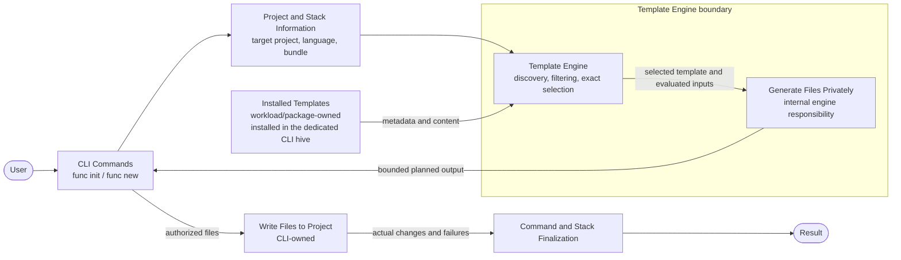
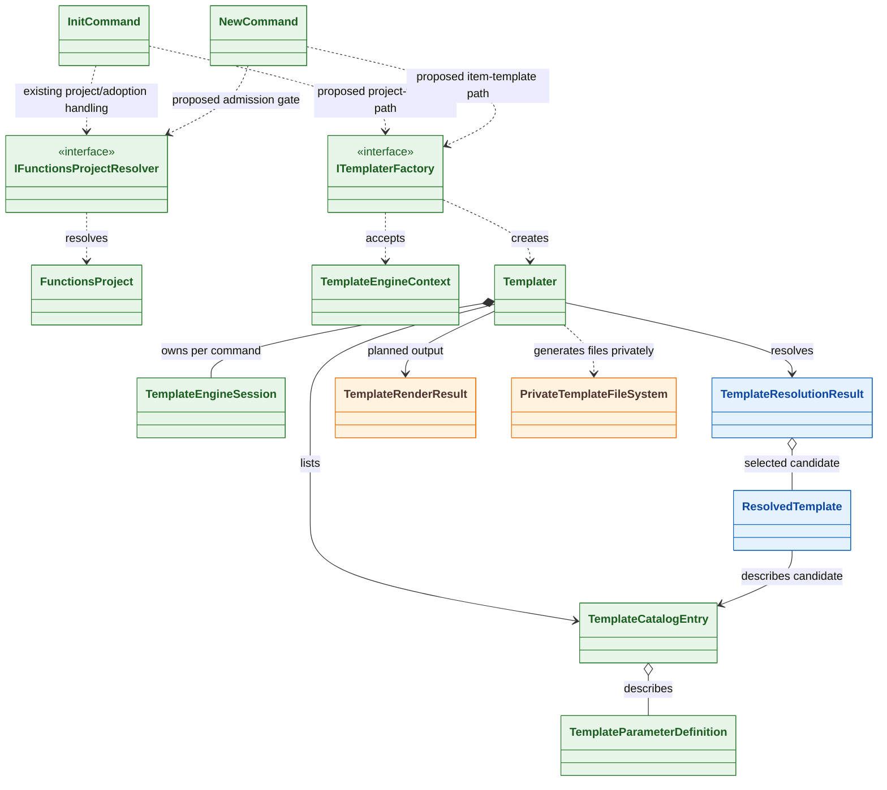
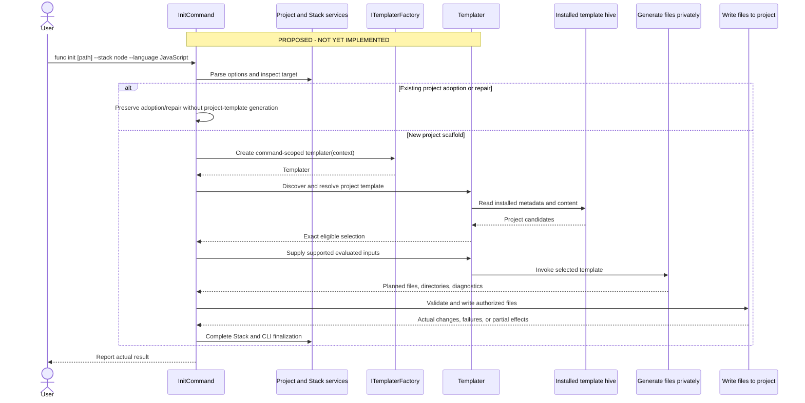
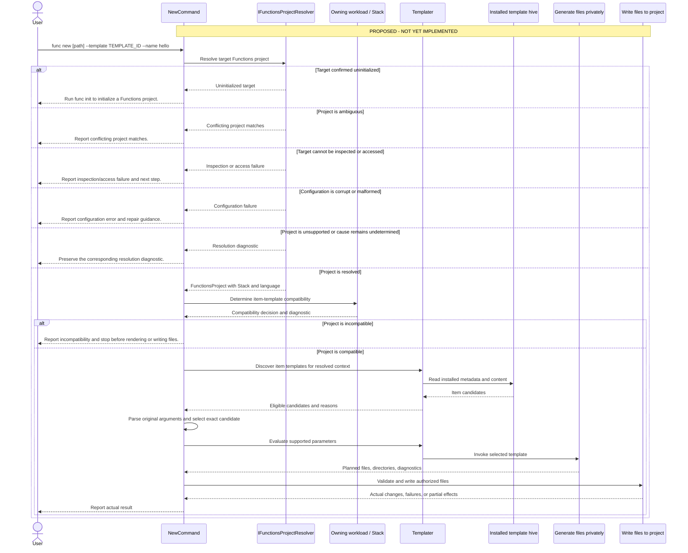

# CLI v5 Templates — Minimum End-to-End Object Model

**Purpose:** Define the implementation responsibilities for the smallest template-backed `func init` and `func new` journey. This model is the implementation authority; proposed behavior is not a claim that the journey is implemented or release-ready.

## Status key

- **Committed baseline:** Present at accepted Core Tools commit `883b02ee9bc10c431a67c044a7f059a082b2fcad`.
- **PR 1 foundation:** Published in PR #5872 at `fe9a0d9861f02596c68ad64c567e3ec0b16bad15`; factory creation, installed-template listing, and resolution through a command-scoped `Templater`.
- **Deferred prototype:** Local rendering code and invocation tests; not included in PR 1.
- **Proposed:** Intended behavior not yet implemented.

**PR 1 contains factory creation, installed-template listing, and resolution through a command-scoped `Templater` only. Only the issuing live `Templater` can re-resolve an issued catalog entry; the selected descriptor itself does not authorize invocation. The private-rendering prototype and invocation tests described below are separate deferred work and are not included in this PR.**

## 1. High-level component architecture

The diagram and walkthroughs describe the intended journey, not the current command implementation. `func init` and `func new` remain command-owned workflows. Workload/package owners supply the installed templates. The Template Engine discovers installed content, selects one exact template, and generates files privately. The CLI decides which planned files may be written, applies command-specific rules, completes finalization, and reports the actual result.

### Walkthrough: `func init`

1. The user runs `func init` with a target folder, Stack, language, and options.
2. **CLI Commands** parses the request and coordinates the operation.
3. **Project and Stack Information** determines the requested Stack and language and whether the target needs new scaffolding, adoption, or repair.
4. **Installed Templates** supplies project-template metadata and content from the dedicated CLI hive.
5. The **Template Engine** filters the installed project templates and selects the exact eligible template.
6. **Generate Files Privately** invokes the selected template without changing the user's destination.
7. The CLI validates the planned files, combines them with CLI-owned configuration, and applies collision and `--force` policy.
8. **Write Files to Project** writes only the authorized files.
9. **Command and Stack Finalization** performs remaining work, such as Node.js package installation, and reports what was created, preserved, skipped, or failed.

> **Short version:** `func init` determines the requested Stack and language, selects the matching installed project template, generates the project privately, writes the authorized files, completes Stack-specific setup, and reports the actual result.

### Walkthrough: `func new`

1. The user runs `func new` with a target project, template choice, function name, and template-specific arguments.
2. **CLI Commands** parses the request and starts the operation.
3. **Project and Stack Information** resolves the existing Functions project and obtains its Stack and language.
4. If resolution does not succeed, the CLI stops before template discovery or file changes and reports the cause: initialization guidance only for a genuinely uninitialized target, an ambiguity diagnostic for conflicting project matches, inspection/access guidance for an inaccessible target, a configuration diagnostic for corrupt or malformed configuration, or the corresponding unsupported-project diagnostic. An unsuccessful resolution alone does not establish that initialization is required.
5. After successful resolution, the owning workload checks item-template compatibility. An incompatible project receives the corresponding diagnostic rather than initialization guidance, without rendering or changing files.
6. **Installed Templates** supplies item-template metadata and content from the dedicated CLI hive.
7. The **Template Engine** filters candidates. The CLI checks the supplied arguments against each eligible candidate and selects one for exact resolution.
8. **Generate Files Privately** invokes that template without changing the project.
9. The CLI validates paths, collisions, and authorization.
10. **Write Files to Project** writes the authorized function files.
11. **Command and Stack Finalization** reports the actual outcome.

> **Short version:** `func new` resolves the existing Functions project, checks Stack compatibility, selects and generates the exact item template privately, then writes the authorized function files and reports the result.

## 2. Minimum object model

Green indicates committed baseline types; blue indicates PR 1 foundation types; orange indicates the deferred rendering prototype. Some baseline types also have PR 1 changes. The command-to-factory edges are proposed, not current calls. Writing files and Stack-owned compatibility are responsibilities, not mandatory new classes. The model does not require `TemplateGroup` or a request/result wrapper for every operation.

### Object journey: `func init`

1. **`InitCommand`** receives the command and owns the public `func init` experience.
2. Existing Stack and initialization infrastructure determines the requested Stack and language and whether the target needs scaffolding, adoption, or repair.
3. For a new project-template path, `InitCommand` creates a **`TemplateEngineContext`** containing the requested command, Stack, language, target, and relevant bundle information.
4. `InitCommand` passes that context to **`ITemplaterFactory`**.
5. `ITemplaterFactory` creates one command-scoped **`Templater`**.
6. `Templater` owns one **`TemplateEngineSession`**, which owns the Microsoft.TemplateEngine environment and installed-template package manager for the command.
7. `Templater` discovers **`TemplateCatalogEntry`** values and uses their metadata and **`TemplateParameterDefinition`** values to identify eligible project templates.
8. `Templater` returns a **`TemplateResolutionResult`** containing either an exact **`ResolvedTemplate`** or structured diagnostics explaining why selection failed.
9. Only the issuing live `Templater` can re-resolve an issued catalog entry. In the proposed path, invocation remains in that session and verifies the selected source before private generation.
10. `Templater` uses **`PrivateTemplateFileSystem`** to generate files without modifying the destination.
11. **`TemplateRenderResult`** returns immutable planned files and directories.
12. `InitCommand` validates and writes the authorized files, then invokes existing Stack-specific finalization.

> **Short version:** `InitCommand` creates a context and gets a command-scoped `Templater`. The `Templater` owns the session, discovers project templates, returns one exact selection, and generates it privately. `InitCommand` decides which planned files may be written and completes project setup.

### Object journey: `func new`

1. **`NewCommand`** receives the project path, template, function name, and remaining template arguments.
2. `NewCommand` calls **`IFunctionsProjectResolver`** with the exact requested target.
3. If resolution fails, `NewCommand` reports the resolution or inspection diagnostic before discovery or file changes. It directs the user to `func init` only when the target is confirmed to be uninitialized; ambiguity, access failures, malformed configuration, and unsupported projects retain their corresponding diagnostics.
4. If resolution succeeds, the resolver returns a **`FunctionsProject`** with Stack and language information.
5. The owning workload evaluates item-template compatibility for that project. If incompatible, `NewCommand` reports the compatibility diagnostic and stops without rendering or file changes.
6. `NewCommand` creates a **`TemplateEngineContext`** from the command and resolved project information.
7. **`ITemplaterFactory`** creates one command-scoped **`Templater`**.
8. `Templater` uses its **`TemplateEngineSession`** to discover installed item-template metadata.
9. `Templater` returns eligible candidates and diagnostics to `NewCommand`.
10. `NewCommand` checks the original command arguments against each eligible candidate's **`TemplateParameterDefinition`** values.
11. `NewCommand` selects one exact candidate. `Templater` resolves it, returning a **`TemplateResolutionResult`** with a **`ResolvedTemplate`** on success and diagnostics as applicable. On success, the proposed path uses the Template Engine to evaluate supported parameters and invoke the selected template through **`PrivateTemplateFileSystem`**.
12. **`TemplateRenderResult`** returns immutable planned function files and directories.
13. `NewCommand` validates and writes the authorized files and reports the actual result.

> **Short version:** `NewCommand` resolves the project, creates a context, and gets a command-scoped `Templater`. The `Templater` resolves the selected item template and, in the proposed path, verifies its source and generates it privately in the same session. `NewCommand` validates the planned files, writes the authorized changes, and reports the outcome.

## 3. `func init` flow

Existing Stack initializers continue serving unmigrated Stacks. Adoption and repair remain separate from new-project generation. A replacement must validate before destructive changes, write only authorized files, and report actual effects.

## 4. `func new` flow

`func new` does not automatically initialize a project. The resolver supplies project facts; the owning Stack determines item-template compatibility. Candidate-specific parsing precedes final selection. Exact-ID failure never widens to a sibling. The current post-cleanup handler does not execute this proposed path.

The branches above describe required command behavior, not new resolver result types or implemented failure classification. The existing [project-resolution result](../../src/Func/Projects/ProjectResolutionResult.cs) carries either `Resolved` or `NotResolved` with a message and optional failure. The [resolver](../../src/Func/Projects/FunctionsProjectResolver.cs) returns the first successful factory match, preserves a reported factory failure, and otherwise reports that no installed workload recognized the directory, with `func setup` guidance. That last result is not proof of an uninitialized project.

The current resolver does not detect conflicting factory matches. [Node project recognition](../../src/Workloads/Stacks/Node/NodeProjectFactory.cs) also accepts weak fingerprints and falls back after malformed JSON; successful recognition is not full configuration validation. These limitations remain command-integration work, not capabilities supplied by PR 1.

Command integration must distinguish the causes above using project inspection and workload checks, preserve known diagnostics and expected access/configuration errors, and avoid initialization advice when the cause is undetermined. Commands own presentation; the resolver and workload retain project recognition and compatibility responsibilities.

## 5. Current implementation status

The renderer is fixture-specific, not a general installed-template API or working command journey. The regular factory does not yet create the private filesystem session. An earlier independent review of the deferred fixture prototype passed with a nonblocking finding; it was a static inspection, not a review of the foundation. The foundation also received a separate source review. At foundation commit `fe9a0d9861f02596c68ad64c567e3ec0b16bad15`, focused tests passed against a hash-verified snapshot with .NET SDK 10.0.403: 108 passed, 0 failed, and 0 skipped. Those results do not cover later review changes, the proposed command flow, or the deferred renderer. Inventory enumeration does not establish general resource isolation. Functions Host execution remains unqualified. The separate Windows fixture probe does not qualify this implementation.

## Object-model review

| Type or responsibility | Status and immediate consumer | Lifetime | Why it is needed / design check |
|---|---|---|---|
| `InitCommand`, `NewCommand` | Committed CLI entry points | One command | Own parsing, orchestration, finalization, and user-facing results; template paths proposed. |
| `IFunctionsProjectResolver`, `FunctionsProject` | Committed; project resolution and future `func new` admission | One resolution / command | Reuse project recognition; recognition is not full template compatibility. |
| `TemplateEngineContext`, `ITemplaterFactory` | Committed baseline; factory/session input | One command | Captures project/Stack/language/bundle context and hides Microsoft.TemplateEngine construction from commands. |
| `TemplaterFactory`, `Templater` | PR 1 foundation; published discovery and exact-selection changes | One engine session per command | Creates the command-scoped Templater; lists metadata and resolves one exact candidate. Commands do not call it yet. |
| `TemplateEngineSession` | PR 1 foundation changes published; rendering filesystem additions deferred | One command | Owns the engine environment and package manager; remains internal to Templater. |
| `TemplateCatalogEntry`, `TemplateParameterDefinition` | Committed metadata | Catalog/session | Describe choices and inputs; not conditional/default evaluation or invocation authority. |
| `TemplateResolutionResult`, `ResolvedTemplate` | PR 1 foundation; selected descriptor returned by `Templater` | Result is caller-held; re-resolution requires the issuing session | Carry the selected descriptor or candidates and diagnostics. Only the issuing live `Templater` can re-resolve an issued catalog entry; the descriptor does not authorize invocation. |
| `PrivateTemplateFileSystem`, `TemplateRenderResult` | Deferred prototype; local and uncommitted | Render/session | Generate fixture files privately and return immutable planned output; not a general sandbox or disk writer. |
| Stack-owned compatibility | Proposed workload responsibility | Per decision | Keep project interpretation outside engine; no mandatory new class. |
| Write Files to Project | Proposed CLI responsibility | Per operation | Authorize filesystem changes and report partial outcomes; concrete type only when a real consumer justifies it. |

The historical Initial Proposal also sketches `TemplateGroup`, `TemplateSelectionCriteria`, `TemplateInvocationRequest`, and `TemplateInvocationResult`. Their names and signatures are not approved API. Use existing descriptors and ordinary method arguments first.

## Implementation direction

The CLI uses one Template Engine for project and item templates.
Commands resolve the requested project or Stack, select an eligible
template, and generate its content privately before writing
authorized changes to disk.

The Template Engine coordinates supported template-defined tasks,
including tasks contributed by individual Stacks. Template packages
use the same Hive registration and discovery contract regardless
of how they are delivered.

Implementation will proceed through small, reviewable increments,
beginning with the command-facing object model and existing
Template Engine infrastructure.

## Code and evidence references

Baseline references point to accepted commit `883b02ee9bc10c431a67c044a7f059a082b2fcad`. PR 1 references point to [PR #5872](https://github.com/Azure/azure-functions-core-tools/pull/5872), head `fe9a0d9861f02596c68ad64c567e3ec0b16bad15`. Local deferred paths are not published GitHub links.

| Responsibility | Primary source/reference |
|---|---|
| Templates status | `docs/templates/README.md` |
| Accepted design | `docs/templates/architecture.md` |
| Commands | `src/Func/Commands/InitCommand.cs`; `src/Func/Commands/NewCommand.cs` |
| Project/Stack | `IFunctionsProjectResolver`; `FunctionsProject`; `NodeWorkload`; `NodeProjectStack`; `NodeProjectFactory` |
| Initializer/Quickstart | `NodeProjectInitializer`; `QuickstartCommand` |
| Committed engine models | `src/Func/Templates/Engine/ITemplaterFactory.cs`; `TemplateEngineContext.cs`; `TemplateCatalogEntry.cs`; `TemplateParameterDefinition.cs` |
| PR 1 code/tests | **PUBLISHED CANDIDATE:** `src/Func/Templates/Engine/TemplateConstraintDeclarationReader.cs`, `TemplaterFactory.cs`, `Templater.cs`, `TemplateEngineSession.cs`, `TemplateResolutionResult.cs`; `test/Func.Tests/Templates/Engine/TemplateConstraintDeclarationReaderTests.cs`, `TemplaterFactoryTests.cs`, `TemplaterTests.cs`; `test/Func.Tests/Templates/TemplateFixtures.cs` (selection fixture only). |
| Deferred rendering | A separate fixture-specific prototype; not part of PR 1 or wired into commands. |
| PR 1 documentation | `docs/templates/README.md`, `architecture.md`, `implementation.md`, and `Templates-EndToEnd-Object-Model-Review.md`. |
| Initial Proposal | **LOCAL / HISTORICAL:** `context/source-evidence/initial-proposal.md` |
| Qualification evidence | The separate Windows fixture probe is not qualification of the production implementation. |

The Template Engine remains inside the CLI for this milestone. Physical extraction under issue #5330 is deferred until after Ignite.
