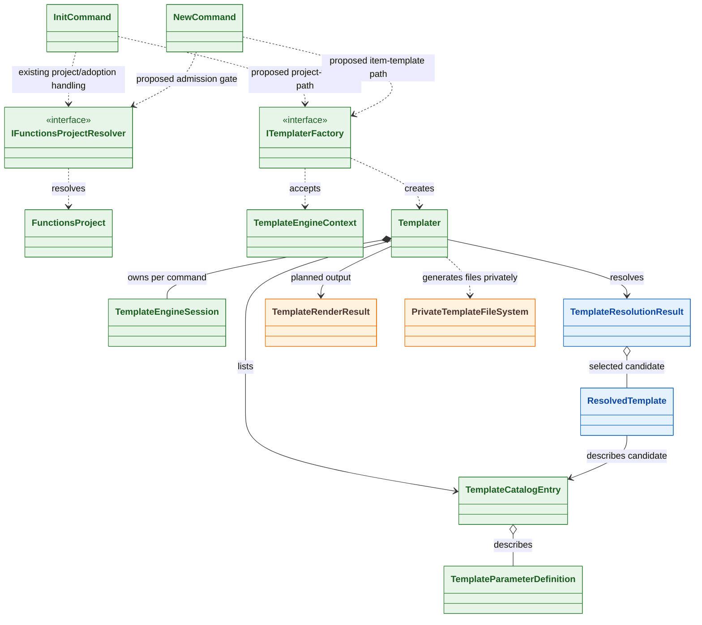
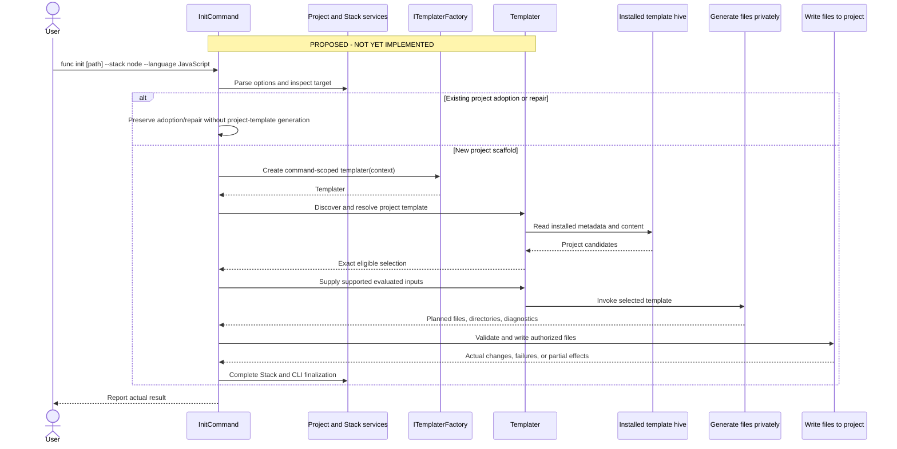
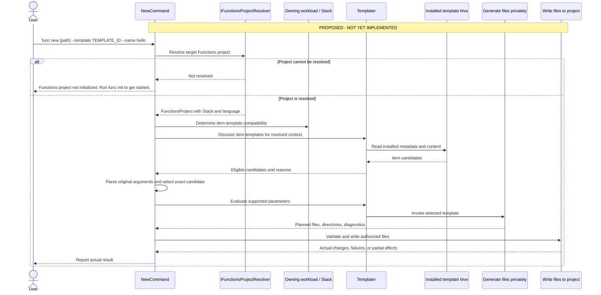
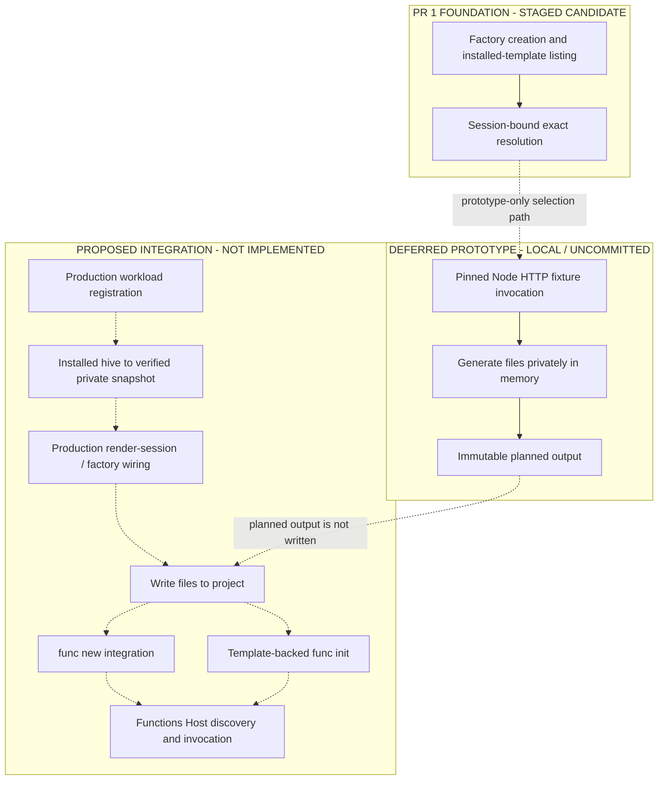

# CLI v5 Templates — Minimum End-to-End Object Model

**Purpose:** Explain the smallest architecture for one template-backed `func init` and `func new` journey. This is a discussion aid, not implementation approval or a release-readiness claim.

## Status key

- **Committed baseline:** Present at accepted Core Tools commit `883b02ee9bc10c431a67c044a7f059a082b2fcad`.
- **PR 1 foundation:** Present in the staged candidate; factory creation, installed-template listing, and session-bound resolution.
- **Deferred prototype:** Local rendering code and invocation tests; not included in PR 1.
- **Proposed:** Intended behavior not yet implemented.

**PR 1 contains factory creation, installed-template listing, and session-bound resolution only. The private-rendering prototype and invocation tests described below are separate deferred work and are not included in this PR.**

## 1. High-level component architecture

`func init` and `func new` remain command-owned workflows. Workload/package owners supply the installed templates. The Template Engine discovers installed content, selects one exact template, and generates files privately. The CLI decides which planned files may be written, applies command-specific rules, completes finalization, and reports the actual result.

### Walkthrough: `func init`

1. The user runs `func init` with a target folder, Stack, language, and options.
2. **CLI Commands** parses the request and coordinates the operation.
3. **Project and Stack Information** determines the requested Stack and language and whether the target needs new scaffolding, adoption, or repair.
4. **Installed Templates** supplies project-template metadata and content from the dedicated CLI hive.
5. The **Template Engine** filters the installed project templates and selects the exact eligible template.
6. **Generate Files Privately** invokes the selected template without changing the user's destination.
7. The CLI validates the planned files, combines them with CLI-owned configuration, and applies collision and `--force` policy.
8. **Write Files to Project** writes only the authorized files.
9. **Command and Stack Finalization** performs remaining work, such as Node.js package installation, and reports what was created, preserved, skipped, or failed.

> **Short version:** `func init` determines the requested Stack and language, selects the matching installed project template, generates the project privately, writes the authorized files, completes Stack-specific setup, and reports the actual result.

### Walkthrough: `func new`

1. The user runs `func new` with a target project, template choice, function name, and template-specific arguments.
2. **CLI Commands** parses the request and starts the operation.
3. **Project and Stack Information** resolves the existing Functions project and obtains its Stack and language.
4. If the project cannot be resolved, the CLI stops with `Functions project not initialized. Run func init to get started.`
5. The owning workload checks whether the project is compatible with the requested item template.
6. **Installed Templates** supplies item-template metadata and content from the dedicated CLI hive.
7. The **Template Engine** filters candidates, checks the supplied arguments, and selects one exact eligible template.
8. **Generate Files Privately** invokes that template without changing the project.
9. The CLI validates paths, collisions, and authorization.
10. **Write Files to Project** writes the authorized function files.
11. **Command and Stack Finalization** reports the actual outcome.

> **Short version:** `func new` resolves the existing Functions project, checks Stack compatibility, selects and generates the exact item template privately, then writes the authorized function files and reports the result.

## 2. Minimum object model

Green indicates committed baseline types; blue indicates PR 1 foundation types; orange indicates the deferred rendering prototype. Some baseline types also have staged edits. The command-to-factory edges are proposed, not current calls. Writing files and Stack-owned compatibility are responsibilities, not mandatory new classes. The model does not require `TemplateGroup` or a request/result wrapper for every operation.

### Object journey: `func init`

1. **`InitCommand`** receives the command and owns the public `func init` experience.
2. Existing Stack and initialization infrastructure determines the requested Stack and language and whether the target needs scaffolding, adoption, or repair.
3. For a new project-template path, `InitCommand` creates a **`TemplateEngineContext`** containing the requested command, Stack, language, target, and relevant bundle information.
4. `InitCommand` passes that context to **`ITemplaterFactory`**.
5. `ITemplaterFactory` creates one command-scoped **`Templater`**.
6. `Templater` owns one **`TemplateEngineSession`**, which manages the Microsoft.TemplateEngine environment and access to installed templates.
7. `Templater` discovers **`TemplateCatalogEntry`** values and uses their metadata and **`TemplateParameterDefinition`** values to identify eligible project templates.
8. `Templater` returns a **`TemplateResolutionResult`** containing either an exact **`ResolvedTemplate`** or structured diagnostics explaining why selection failed.
9. The resolved template remains tied to the session that created it.
10. `Templater` uses **`PrivateTemplateFileSystem`** to generate files without modifying the destination.
11. **`TemplateRenderResult`** returns immutable planned files and directories.
12. `InitCommand` validates and writes the authorized files, then invokes existing Stack-specific finalization.

> **Short version:** `InitCommand` creates a context and gets a command-scoped `Templater`. The `Templater` owns the session, discovers project templates, returns one exact selection, and generates it privately. `InitCommand` decides which planned files may be written and completes project setup.

### Object journey: `func new`

1. **`NewCommand`** receives the project path, template, function name, and remaining template arguments.
2. `NewCommand` calls **`IFunctionsProjectResolver`** with the exact requested target.
3. If resolution fails, `NewCommand` returns the initialization guidance before discovery or file changes.
4. If resolution succeeds, the resolver returns a **`FunctionsProject`** with Stack and language information.
5. The owning workload evaluates item-template compatibility for that project.
6. `NewCommand` creates a **`TemplateEngineContext`** from the command and resolved project information.
7. **`ITemplaterFactory`** creates one command-scoped **`Templater`**.
8. `Templater` uses its **`TemplateEngineSession`** to discover installed item-template metadata.
9. `Templater` returns a **`TemplateResolutionResult`** containing eligible candidates, diagnostics, or one exact **`ResolvedTemplate`**.
10. The original command arguments are checked against that candidate's **`TemplateParameterDefinition`** values.
11. `Templater` invokes the exact resolved template through **`PrivateTemplateFileSystem`**.
12. **`TemplateRenderResult`** returns immutable planned function files and directories.
13. `NewCommand` validates and writes the authorized files and reports the actual result.

> **Short version:** `NewCommand` resolves the project, creates a context, and gets a command-scoped `Templater`. The `Templater` selects one exact item template tied to its session and generates it privately. `NewCommand` validates the planned files, writes the authorized changes, and reports the outcome.

## 3. `func init` flow

Existing Stack initializers continue serving unmigrated Stacks. Adoption and repair remain separate from new-project generation. A replacement must validate before destructive changes, write only authorized files, and report actual effects.

## 4. `func new` flow

`func new` does not automatically initialize a project. The resolver supplies project facts; the owning Stack determines item-template compatibility. Candidate-specific parsing precedes final selection. Exact-ID failure never widens to a sibling. The current post-cleanup handler does not execute this proposed path.

## 5. Current implementation status

The renderer is fixture-specific, not a general installed-template API or working command journey. The regular factory does not yet create the private filesystem session. The latest Principal verdict of **PASS WITH NONBLOCKING FINDING** applies only to the deferred bounded fixture prototype: write-time quotas, bounded source reads, cancellation checks, and exact-byte assertions were inspected statically. It does not review or qualify the PR 1 foundation. Inventory enumeration does not establish general resource isolation. Lane 3 build/test and Host execution are not established by this document. Lane 4's Windows probe is separate evidence and is not Lane 3 runtime qualification.

## Object-model review

| Type or responsibility | Status and immediate consumer | Lifetime | Why it is needed / design check |
|---|---|---|---|
| `InitCommand`, `NewCommand` | Committed CLI entry points | One command | Own parsing, orchestration, finalization, and user-facing results; template paths proposed. |
| `IFunctionsProjectResolver`, `FunctionsProject` | Committed; project resolution and future `func new` admission | One resolution / command | Reuse project recognition; recognition is not full template compatibility. |
| `TemplateEngineContext`, `ITemplaterFactory` | Committed baseline; factory/session input | One command | Captures project/Stack/language/bundle context and hides Microsoft.TemplateEngine construction from commands. |
| `TemplaterFactory`, `Templater` | PR 1 foundation; staged discovery and exact-selection changes | One engine session per command | Creates the command-scoped Templater; lists metadata and resolves one exact candidate. Commands do not call it yet. |
| `TemplateEngineSession` | PR 1 foundation changes staged; rendering filesystem additions deferred | One command | Owns the engine environment and package manager; remains internal to Templater. |
| `TemplateCatalogEntry`, `TemplateParameterDefinition` | Committed metadata | Catalog/session | Describe choices and inputs; not conditional/default evaluation or invocation authority. |
| `TemplateResolutionResult`, `ResolvedTemplate` | PR 1 foundation; staged candidate returned by Templater | Originating session | Preserve reasons and bind the exact selection to its issuing session; they do not expose an invocation locator in PR 1. |
| `PrivateTemplateFileSystem`, `TemplateRenderResult` | Deferred prototype; local and uncommitted | Render/session | Generate fixture files privately and return immutable planned output; not a general sandbox or disk writer. |
| Stack-owned compatibility | Proposed workload responsibility | Per decision | Keep project interpretation outside engine; no mandatory new class. |
| Write Files to Project | Proposed CLI responsibility | Per operation | Authorize filesystem changes and report partial outcomes; concrete type only when a real consumer justifies it. |

The historical Initial Proposal also sketches `TemplateGroup`, `TemplateSelectionCriteria`, `TemplateInvocationRequest`, and `TemplateInvocationResult`. Their names and signatures are not approved API. Use existing descriptors and ordinary method arguments first.

## Implementation direction

The CLI uses one Template Engine for project and item templates.
Commands resolve the requested project or Stack, select an eligible
template, and generate its content privately before writing
authorized changes to disk.

The Template Engine coordinates supported template-defined tasks,
including tasks contributed by individual Stacks. Template packages
use the same Hive registration and discovery contract regardless
of how they are delivered.

Implementation will proceed through small, reviewable increments,
beginning with the command-facing object model and existing
Template Engine infrastructure.

## Code and evidence references

Committed references point to accepted baseline `883b02ee9bc10c431a67c044a7f059a082b2fcad`. Local candidate paths are not published GitHub links.

| Responsibility | Primary source/reference |
|---|---|
| Templates status | `docs/templates/README.md` |
| Accepted design | `docs/templates/architecture.md` |
| Commands | `src/Func/Commands/InitCommand.cs`; `src/Func/Commands/NewCommand.cs` |
| Project/Stack | `IFunctionsProjectResolver`; `FunctionsProject`; `NodeWorkload`; `NodeProjectStack`; `NodeProjectFactory` |
| Initializer/Quickstart | `NodeProjectInitializer`; `QuickstartCommand` |
| Committed engine models | `src/Func/Templates/Engine/ITemplaterFactory.cs`; `TemplateEngineContext.cs`; `TemplateCatalogEntry.cs`; `TemplateParameterDefinition.cs` |
| PR 1 staged code/tests | **STAGED CANDIDATE:** `src/Func/Templates/Engine/TemplateConstraintDeclarationReader.cs`, `TemplaterFactory.cs`, `Templater.cs`, `TemplateEngineSession.cs`, `TemplateResolutionResult.cs`; `test/Func.Tests/Templates/Engine/TemplateConstraintDeclarationReaderTests.cs`, `TemplaterFactoryTests.cs`, `TemplaterTests.cs`; `test/Func.Tests/Templates/TemplateFixtures.cs` (selection fixture only). |
| Deferred rendering code/tests | **LOCAL / UNCOMMITTED — NOT IN PR 1:** `FuncTemplateEngineHost.cs`, `PrivateTemplateFileSystem.cs`, `TemplateRenderResult.cs`, `TemplaterInvocationTests.cs`; render-only portions of `Templater.cs`, `TemplateEngineSession.cs`, and `TemplateFixtures.cs`; invocation locator members in the worktree version of `TemplateResolutionResult.cs`. |
| PR 1 documentation | **STAGED CANDIDATE:** `docs/templates/README.md`, `architecture.md`, `implementation.md`, `Templates-EndToEnd-Object-Model-Review.md`. |
| Initial Proposal | **LOCAL / HISTORICAL:** `context/source-evidence/initial-proposal.md` |
| Lane 4 content | **SEPARATE LOCAL CANDIDATE:** `Templates-NodeHttp-Qualification/azure-functions-templates/Docs/node-http-qualification.md` and `Functions.Templates/NodeHttpQualification/content/` |

The Template Engine remains inside Core Tools for this milestone. Physical extraction under issue #5330 is deferred until after Ignite.
