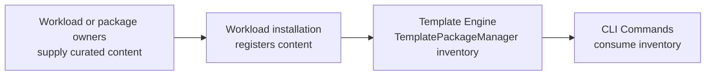

# CLI v5 Templates: Component Model

## Purpose and scope

This model defines the responsibilities for the Template Engine foundation and later command integration. PR #5872 provides command-scoped installed-template discovery and exact selection. It does not acquire or register workload content, create templates, write generated files, activate `func init` or `func new`, or qualify a Functions Host journey.

The six responsibilities below are boundaries, not six required classes:

1. **CLI Commands** own command arguments, prompting, orchestration, diagnostics, and later file writing.
2. **Project and Stack Information** owns project interpretation and Stack-specific compatibility.
3. **Template Engine** owns engine sessions, installed inventory, template metadata, selection policy, engine constraints, and exact candidate resolution.
4. **Installed Templates** are registered content discovered and cached by `TemplatePackageManager`.
5. **Generate Files Privately** is a later integration responsibility.
6. **Write Files to Project** is a later CLI responsibility.

PR #5872 is discovery and selection only. Creation and writing files belong to later integration work; this change does not define their implementation.
These names describe product responsibilities. They do not require six classes and do not prescribe a virtual filesystem, private byte rendering, a custom file writer, or rollback. PR #5872 implements only the discovery and selection foundation.

## Content and inventory ownership



Workload or package owners supply curated template content. Workload installation registers it with the Template Engine before reporting it ready. The command-scoped `TemplatePackageManager` owns installed-template discovery and inventory; commands consume that inventory. A registered bounded root may contain multiple templates, and recursive discovery belongs to the Template Engine. Workload acquisition, root declarations, readiness, servicing, and re-registration are outside PR #5872.

`TemplateEngineSession` owns one `EngineEnvironmentSettings`, one `TemplatePackageManager`, a cached runtime-read-only snapshot of the command inventory, and disposal. The snapshot retains the exact package and `ITemplateInfo` objects returned by the manager without exposing its caller-owned collections. `Templater` is the command-facing owner of that session: it obtains the inventory once, projects minimum CLI metadata, retains exact engine candidates, and enforces candidate lifetime. It does not scan mounts or rerun generators.

`TemplateSelection` is a single internal operation over that already-loaded inventory. It owns identity and alias matching, kind filtering, ambiguity, and selection-result policy. It delegates candidate eligibility to the concrete internal `TemplateEligibilityEvaluator`, which owns hidden and invalid metadata checks, source-backed constraint validation, and candidate-scoped rejection diagnostics. This split keeps source I/O and engine constraint evaluation out of matching without introducing a second inventory or an evaluator interface. `TemplateSelection` is the evaluator's immediate production consumer; `Templater` directly consumes the selection operation, and the factory composes both with one command-scoped session. No public selection API is introduced.

## Discovery and selection

`TemplateCatalogEntry` is a minimal CLI description of a project or item template. It retains identity, display metadata, non-empty aliases, group identity, language, package information, and diagnostics for unusable Functions host or required template metadata. It is not a replacement for the engine candidate.

Each `TemplateCatalogEntry` retains the exact engine-owned `ITemplateInfo` internally; it is not reconstructed from projected metadata or exposed as command-facing public API. The owning live `Templater` validates a non-owning session token and exact inventory membership before resolving or retrieving that candidate. An immutable copy remains valid when it preserves the same token and candidate. Foreign, unbound, forged, and disposed-session entries are rejected. Registered content is treated as immutable during the command; servicing or re-registration occurs outside that session.

The result has only `Candidates` and `Diagnostics`, with one strict count contract:

| Candidate count | Meaning and caller responsibility |
| --- | --- |
| `0` | Unsuccessful; inspect structured diagnostics. A `not-found` diagnostic does not prove provider enumeration was complete. |
| `1` | Selected; use `Candidates[0]` and its projected parameters. |
| `2` or more | Ambiguous; the caller must choose explicitly. |

Failures never return candidates. Their identity, package, name, kind, source, and rejection cause are retained in structured diagnostics as applicable. `TemplateResolutionResult` takes internally owned arrays without adding defensive wrappers. Catalog entries continue to snapshot caller-owned aliases, parameters, and nested parameter choices.

The downstream command pattern is to resolve once, inspect `Candidates.Count`, display diagnostics when the count is not one, then use `Candidates[0]`. Read selected parameters from that entry and pass the same entry back through the same live `Templater` for exact engine use. There is no separate `TemplateResolutionStatus`, `SelectedTemplate`, or `ResolvedTemplate`.

An exact identity takes precedence over aliases. If the returned inventory contains multiple entries with one identity, resolution fails rather than choosing one. An alias resolves only its matching templates; it does not widen to sibling variants. Two or more eligible matches remain in the result and are ambiguous, whether or not they share a family. The engine does not choose a family member automatically.

### Template metadata

The following fictional item templates illustrate these fields. Templates require at least one non-empty `shortName`: the engine may omit a template with no value, while projection filters empty aliases and marks an exposed candidate with no usable alias as invalid:

```json
{
  "identity": "Example.Http.JavaScript",
  "groupIdentity": "Example.Http",
  "shortName": "http",
  "tags": { "type": "item", "language": "JavaScript" }
}
```

```json
{
  "identity": "Example.Http.TypeScript",
  "groupIdentity": "Example.Http",
  "shortName": "http",
  "tags": { "type": "item", "language": "TypeScript" }
}
```

The identities uniquely identify two variants in one descriptive family. `groupIdentity` identifies related variants; it does not select one. The shared `shortName` is an alias and can be ambiguous. A separate fictional template could use `"identity": "Example.Timer.JavaScript"`, `"groupIdentity": "Example.Timer"`, and `"shortName": "timer"`. `tags.type` distinguishes `item` from `project`.

`func init` selects project templates. `func new` selects item templates. Quickstarts remain project templates. A future command may request candidates and diagnostics, own the prompt, then pass the exact selected candidate back; PR #5872 adds no no-reference prompting API because there is no authorized production consumer.

## Eligibility and diagnostics

`TemplateEligibilityEvaluator` evaluates engine constraints through `TemplateConstraintManager`. It preserves the raw declaration checks needed for malformed or duplicate declarations, verifies that exactly one matching engine factory exists, and reads only the candidate's declared configuration through the existing session. A constraint that cannot be evaluated because a required provider is unavailable rejects only that candidate with `constraint-not-evaluated`; it does not prevent other candidates from resolving. Cancellation remains cancellation. The evaluator's result is either eligible with no diagnostics or rejected with exactly one diagnostic identifying that candidate.

The narrow Functions `func-bundle` constraint uses the bundle context already attached to the command-scoped engine session; it does not interpret a project or Stack. The lazy `FuncTemplateConstraintEvaluator` is used only for that declared constraint. A `func-workload` constraint cannot be evaluated until a workload inventory exists, so it fails closed.

PR #5872 does not perform project Stack or language compatibility checks. The downstream PR #5878 command consumes `ITemplaterFactory`; project interpretation and compatibility belong to the owning Stack, not to template matching. The project context may be carried by the session, but this selection foundation does not use it to filter or reject candidates.

Diagnostics retain their code, template identity, package identity, and original exception when those values are available. Listing propagates an engine inventory exception unchanged; resolution returns it as the diagnostic cause. No custom listing exception or message parsing is introduced.

The Template Engine inventory may not expose every conflicting registration as a distinct candidate. This layer does not enumerate mounts again to detect duplicate registrations; immutable, versioned workload content must avoid identity conflicts. Some Template Engine providers may also log or suppress enumeration errors and return a partial inventory. The CLI does not parse logs to infer completeness. In that case, a zero-candidate result with a `not-found` diagnostic may reflect an incomplete inventory; these limitations remain explicit.

## Later integration

Creation and writing files are later integration work. This discovery/selection change defines no generation or publication mechanics; those contracts require separate accepted architecture and authorization.

Workload registration alone does not qualify template-backed commands. Qualification requires content delivery and readiness, project and Stack compatibility, command integration, supported parameters and defaults, Template Engine creation, approved workload tasks, generated-project validation, and supported-platform coverage. These are separate end-to-end gates, not PR #5872 results.

## References

- [Architecture](architecture.md)
- [Implementation](implementation.md)
- Engine session and factory: `src/Func/Templates/Engine/TemplateEngineSession.cs`, `TemplaterFactory.cs`
- Inventory, matching, and eligibility: `src/Func/Templates/Engine/Templater.cs`, `TemplateSelection.cs`, `TemplateEligibilityEvaluator.cs`, `TemplateResolutionResult.cs`
- Metadata projection and constraints: `TemplateCatalogProjector.cs`, `TemplateConstraintDeclarationReader.cs`
