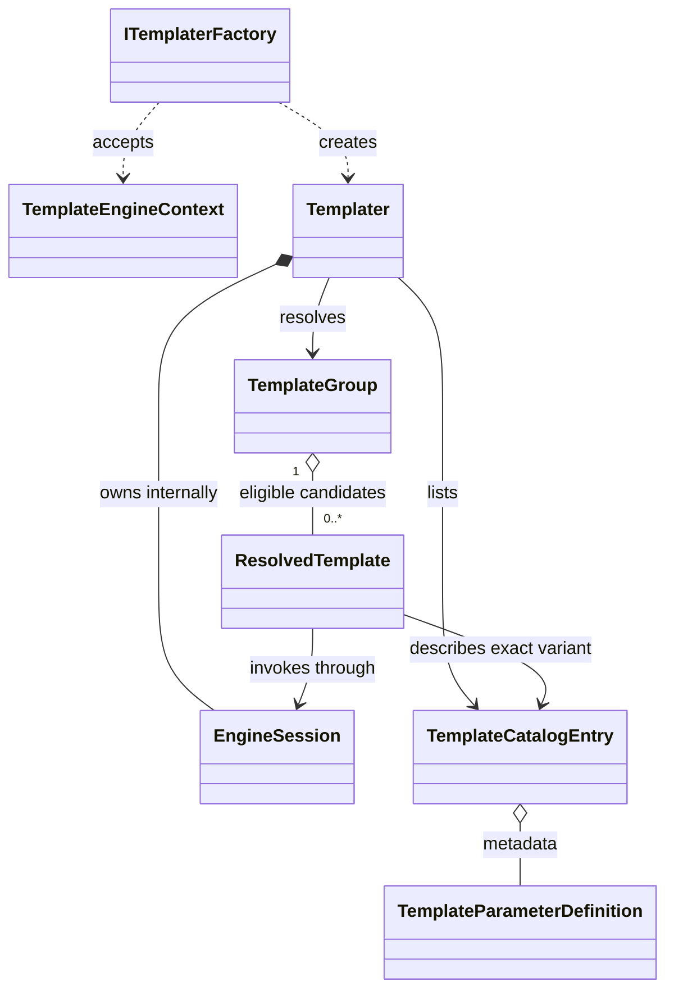
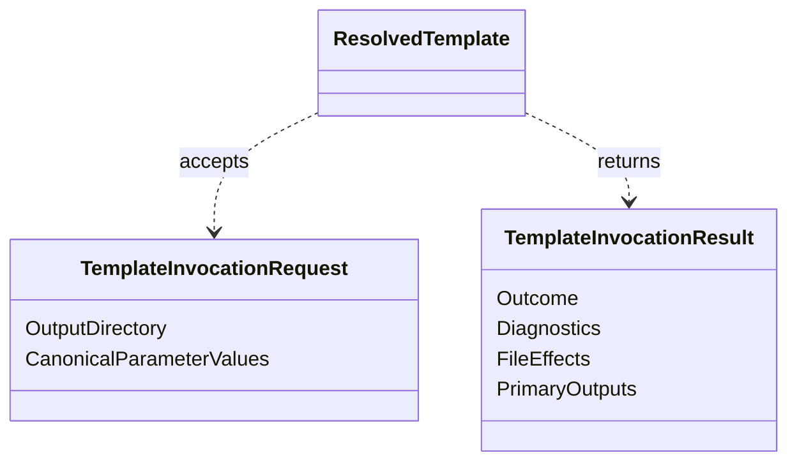
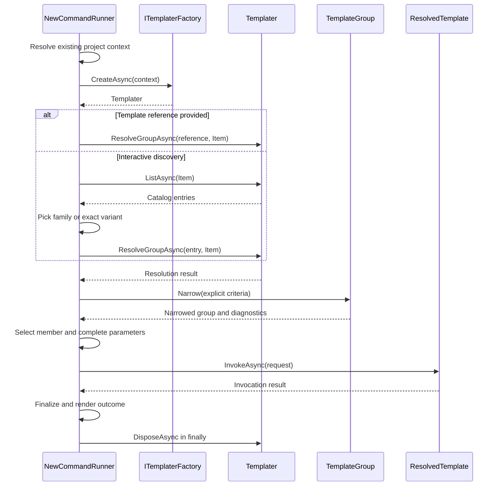

# CLI v5 Templates — Fabio's Object-Model Draft

> **Preserved historical starting proposal (October 30, 2026).** Proposed type names/signatures below are not mandatory current APIs. See [Templates Architecture](../../README.md) for the current proposed Phase 6 contract and outstanding approval gates; the original draft body is retained for provenance.

- **Status:** Proposed starting architecture; API shapes not approved.
- **Design source:** Fabio Cavalcante's October 30 object-model proposal.
- **Captured:** October 30, 2026; this copy was supplied by Francisco as an attachment, not retrieved from a Git commit.
- **Implementation baseline:** `feature/templates-engine-redesign` (reviewed cleanup; no implementation approval).

Draft proposal to establish a small command-facing contract for the single templating engine used by `func new` and `func init`.

The release outcome is a reusable engine demonstrated with a minimal project and item template per supported stack. Additional templates can follow. The signatures below are proposed API shapes, not a statement of the current repository implementation.

## Architectural boundaries

The command runner resolves context, coordinates argument parsing, prompts, selects a candidate, and handles finalization. The templater owns the engine session and exposes discovery and resolution. A resolved template invokes one exact candidate through that session.

Keep Microsoft.TemplateEngine types internal to the integration. Keep CLI configuration finalization under CLI ownership. Remove the legacy Templates.DotNet and Templates.V2 projects and their exclusive consumers; there is no engine selector or fallback. Temporary unavailability of scaffolding is acceptable during removal, provided unavailable operations fail before modifying files.

## Core object model

| Entity | Responsibility | Key relationships |
| - | - | - |
| `TemplateEngineContext` | Immutable snapshot of command directory, optional existing-project context, and applicable bundle or workload context. | Supplied to the factory; shared by the session. No console, parser, or mutable command state. |
| `ITemplaterFactory` | Creates a command-scoped templater. | Accepts context; returns the disposable session owner. |
| `Templater` | Lists catalog entries and resolves a reference or catalog selection into a family of eligible candidates. | Owns the internal engine session. Creates groups and candidates. |
| `TemplateCatalogEntry` | Describes one concrete installed template, including unavailable templates. | Carries exact identity, explicit group identity, aliases, kind, language, precedence, parameter metadata, origin, and eligibility diagnostics. No invocation method. |
| `TemplateGroup` | Immutable view of eligible variants in one template family. | Contains zero or more resolved templates and retained diagnostics. Narrowing returns another view without changing the original. |
| `ResolvedTemplate` | Represents one exact eligible template variant. | Exposes its descriptor and parameter definitions. Invokes through its originating session. Construction is restricted to the integration. |
| `TemplateParameterDefinition` | Describes a template input independently of a CLI parser. | Canonical name, aliases, data type, choices, default semantics, requiredness, and visibility. Shared by help, parsing, validation, and invocation. |
| `TemplateInvocationRequest` | Supplies values and generation options for the already selected candidate. | Output directory and canonical parameter values; add conflict or preview options only where required. No template identity or engine choice. |
| `TemplateInvocationResult` | Describes the generation outcome without exposing engine objects. | Typed outcome, diagnostics, file effects, primary outputs, and supported finalization data. |

Use internal types unless an assembly boundary requires otherwise. An interface is useful at the factory boundary; do not introduce an interface for every entity by default.

## Ownership and relationships



`EngineSession` is a conceptual internal collaborator here, not a requirement to introduce a new named class. Groups and candidates do not dispose the session. Their invocation capability expires when the owning templater is disposed; metadata can remain readable.



## What a group means

A group is a family defined by an explicit group identity in template metadata. For example, an HTTP trigger family could contain C#, JavaScript, and Python variants. Matching display names do not establish a family.

There are three different identities to preserve:

| Identity | Meaning |
| - | - |
| Template identity | One concrete installed variant. Must remain unambiguous within the session, including package/version provenance when necessary. |
| Group identity | The family to which the variant belongs. |
| User reference | A name or alias supplied to the command. May match no family, one family, or several families. |

A catalog entry describes one variant. A group contains eligible variants of one family. A selected candidate is an existing member of that group, not a newly constructed object or a fresh lookup.

When no group identity exists, the proposed default is a singleton family keyed by the exact template identity. Confirm this against the integration's metadata rules before implementation.

Resolution and narrowing are separate. Resolution identifies one family and evaluates eligibility against the session context and requested template kind. Narrowing applies additional explicit selection criteria. The command owns the selection policy; the integration owns consistent application of template metadata and engine constraints.

Zero candidates means no eligible match and must retain the reasons. One candidate can be selected directly. Multiple candidates require an explicit policy, a prompt, or an ambiguity error in non-interactive use. Precedence must be an agreed rule, not an incidental collection-order tie-breaker.

## Proposed API shape

This is a contract sketch, not a compiling implementation. Reuse existing repository models where they already express these responsibilities. Avoid introducing duplicate context or parameter types.

```csharp
internal interface ITemplaterFactory
{
    Task<Templater> CreateAsync(
        TemplateEngineContext context,
        CancellationToken cancellationToken);
}

internal sealed class Templater : IAsyncDisposable
{
    public Task<IReadOnlyList<TemplateCatalogEntry>> ListAsync(
        TemplateKind kind,
        CancellationToken cancellationToken);

    public Task<TemplateResolutionResult> ResolveGroupAsync(
        string reference,
        TemplateKind kind,
        CancellationToken cancellationToken);

    public Task<TemplateResolutionResult> ResolveGroupAsync(
        TemplateCatalogEntry selectedEntry,
        TemplateKind kind,
        CancellationToken cancellationToken);

    public ValueTask DisposeAsync();
}

internal sealed class TemplateGroup
{
    public string GroupIdentity { get; }
    public IReadOnlyList<ResolvedTemplate> Candidates { get; }
    public IReadOnlyList<TemplateDiagnostic> Diagnostics { get; }

    public TemplateGroup Narrow(TemplateSelectionCriteria criteria);
}

internal sealed class ResolvedTemplate
{
    public TemplateCatalogEntry Descriptor { get; }

    public Task<TemplateInvocationResult> InvokeAsync(
        TemplateInvocationRequest request,
        CancellationToken cancellationToken);
}
```

The catalog-selection overload consumes an entry issued by the same session. It resolves its explicit family without looking up its display name. If the picker selected a concrete variant, the runner selects the returned member with that exact identity. If the picker selected a family, normal narrowing follows. Reject foreign or stale entries rather than quietly resolving them again.

`TemplateResolutionResult`, `TemplateDiagnostic`, and `TemplateSelectionCriteria` are small supporting value models, not new service layers. Resolution should distinguish resolved family, reference not found, wrong kind, and ambiguous family. A resolved family can contain zero eligible candidates and explain why. Never merge multiple matching families into a synthetic group.

Keep criteria limited to fields the first command journey needs. Do not create a predicate language or general filtering framework. Immutable narrowing preserves prior exclusions and records new rejection reasons.

Parameter metadata has one canonical representation. A resolved template can expose it through its descriptor; a convenience property must not create a second mutable copy. Defaults that depend on engine evaluation should remain distinguishable from literal defaults.

## Command execution

`NewCommandRunner` is the orchestration entry point. Its engine entry point is the templater created for that command's context.



Resolve failures before accessing the group. Parse candidate-specific options against the candidate metadata; do not combine incompatible parameter definitions into one schema. Missing required input can be prompted for after selection. An eligible candidate does not imply a complete invocation request.

`InvokeAsync` validates canonical names, values, required inputs, output location, and applicable conflict policy before generation. The command performs validation for useful UX; the integration still protects its invocation boundary. No prompt or raw command token parsing belongs inside invocation.

The runner disposes the templater on success, failure, and cancellation. Invocation after disposal fails explicitly.

| Concern | func new | func init |
| - | - | - |
| Context | Existing function app and project metadata. | Target directory and requested project settings; an existing project is not required. |
| Template kind | Item. | Project. |
| Selection and invocation | Shared contract. | Shared contract. |
| Finalization | Supported item-generation follow-up. Preserve unrelated project content. | Required CLI-owned project configuration, using actual generated outputs. |

Generation success and command success are distinct. If CLI configuration finalization fails after generation, report a failed command and identify the files already created. Do not imply transactional rollback unless implemented.

## Outcomes and diagnostics

Use typed outcomes for expected resolution, validation, and conflict failures. Diagnostics should identify the candidate or parameter involved and carry a stable code plus displayable details. Do not use a single success boolean to represent every failure mode.

Cancellation follows the repository's async conventions. Unexpected internal failures remain distinguishable from user input errors. Neither cancellation nor failure implies that no writes occurred; report known file effects when generation has begun.

Keep post-actions bounded to the initial templates' actual needs. Do not expose raw engine action objects or build a general post-action framework in the scaffolding PR. CLI configuration remains mandatory command finalization, not an optional best-effort action.

## Initial scaffolding PR

Fabio's PR should make the contract reviewable and leave implementation choices open.

1. Reuse or define the immutable data models and the entry-point signatures above.

2. Document family identity, eligibility, selection, session lifetime, and command ownership beside the contract.

3. Include a short caller example showing creation, resolution, selection, parameter completion, invocation, and disposal.

4. Implement simple data behavior where it is clear. Engine-dependent stubs throw explicitly; they never return fabricated success or silently empty results.

5. Keep unavailable command operations guarded before filesystem changes, including force-related cleanup.

6. Leave internal adapters, caches, package acquisition machinery, and service decomposition to the working implementation.

Keep legacy removal in its own focused PR. Do not copy removed legacy types into the new layer to make the skeleton compile.

## First working increment

Francisco's first implementation increment should make one item template generate files through the real `func new` command using this contract.

Acceptance checks:

- A known template can be discovered and resolved in a command-scoped session.

- A listed selection preserves its exact identity through invocation.

- A required parameter reaches the generated output under its canonical name.

- An invalid parameter or unavailable candidate produces a useful failure before generation.

- Narrowing leaves the original group unchanged and retains exclusion reasons.

- Existing unrelated files are preserved; conflicts follow an explicit policy.

- Session disposal is guaranteed and post-disposal invocation is rejected.

Then implement one project template through `func init`, verify required CLI configuration, and add an item to the generated project. Expand minimal coverage across stacks after those journeys work. New templates within supported capabilities should not require CLI code changes.

## Decisions to refine together

| Decision | Starting proposal |
| - | - |
| Catalog presentation | Engine lists concrete variants; CLI may group them for display. |
| Catalog selection | Session-bound entry resolves the family and preserves exact-variant selection when applicable. |
| Naming | Keep ResolvedTemplate initially; document that it is eligible, not necessarily selected or parameter-complete. |
| Family fallback | Templates without a group identity form singleton families. |
| Precedence | Explicit selection policy, confirmed with the first multi-variant fixture. |
| Invocation options | Add only required conflict behavior first; preview/dry-run is deferred unless needed for the milestone. |
| Finalization | CLI owns required configuration; define the minimal output metadata needed by init. |
| Disposal | Async disposal shown provisionally; align with actual session resource requirements. |

The first working slice may justify changing signatures. Preserve the ownership boundaries while using concrete implementation evidence to refine the model.
