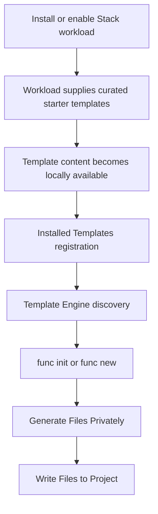
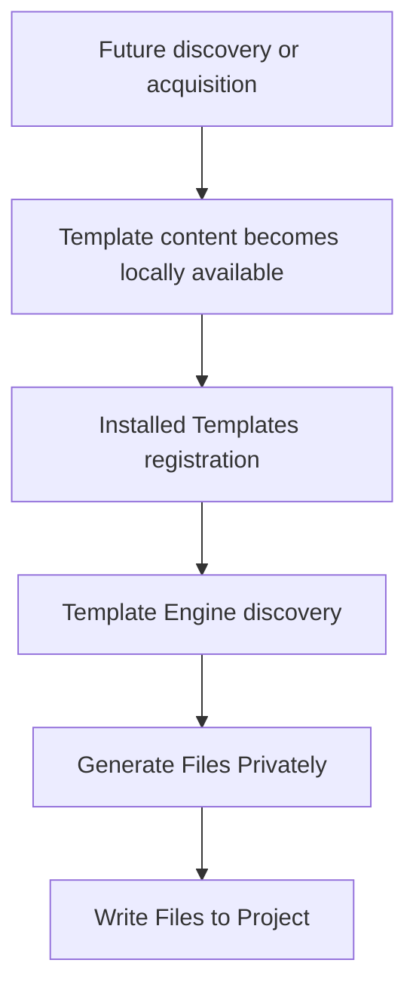
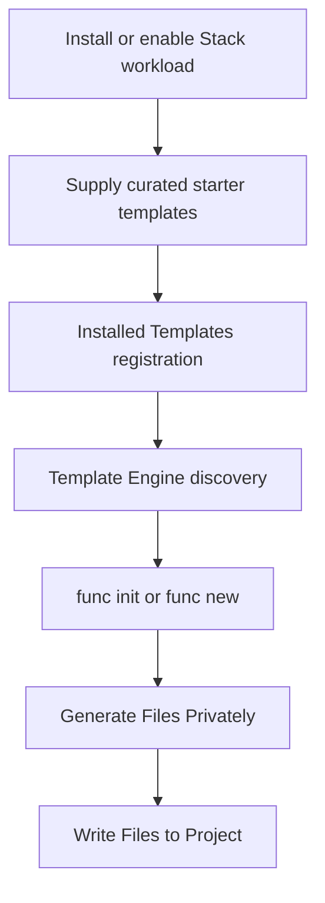
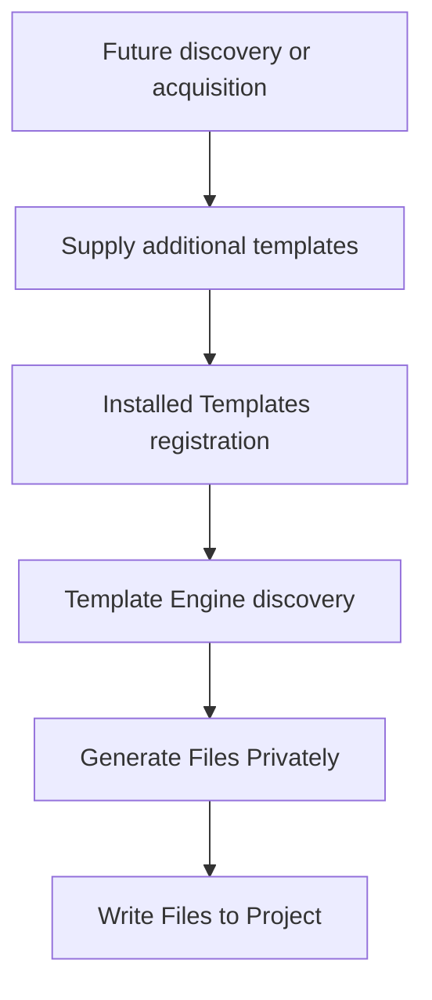

# CLI Template Packaging and Acquisition Contract

**Status:** Proposed for review.

This document defines the CLI template packaging, supply, registration, discovery, and acquisition contract.

Package identities, workload delivery details, versioning, servicing, and future package-management experiences remain owner decisions unless explicitly defined below.

The Template Engine architecture is defined separately by the accepted CLI Templates object model.

---

## Purpose

This document defines how template content becomes available to CLI and how CLI uses that content.

The design separates these responsibilities:

1. Template supply
2. Installed Templates registration
3. Template discovery
4. Template generation
5. Write Files to Project

This separation allows template delivery to evolve without changing how `func init` and `func new` discover and use templates.

Microsoft.TemplateEngine is the Template Engine implementation.

---

## Established Boundary

Stack and content owners provide project and item templates independently of the Template Engine.

For GA, installing or enabling a Stack workload supplies the starter template content required for that Stack's supported CLI experience and ensures that content reaches the Installed Templates registration boundary.

Once template content is locally available and registered, the Template Engine treats the content the same regardless of how the content was physically delivered.

Commands do not acquire their required GA starter templates as a side effect.

The responsibilities are:

- **Template supply** makes approved template content locally available.
- **Installed Templates** registers locally available content in the CLI Template Engine Hive.
- **Template Engine** discovers registered templates, evaluates supported template semantics, and generates files privately.
- **Project and Stack Information** interprets the target project and Stack-specific compatibility.
- **CLI Commands** orchestrate the command and authorize project effects.
- **Write Files to Project** applies authorized changes to the target project.
- **Template Engine** coordinates supported template-defined tasks, while a Stack may provide Stack-specific task implementations.

`func init` uses project templates.

`func new` uses item templates.

Quickstarts are project templates, not a separate template kind.

---

## Template Supply

Template supply determines how template content becomes locally available to CLI.

For GA, installing or enabling a Stack workload supplies the curated starter templates required for that Stack's supported `func init` and `func new` experiences.

Examples of locally available template content may include:

- Template packages supplied with a Stack workload.
- Template content supplied in a supported local directory.
- Future user-acquired template packages.

The physical delivery mechanism may differ by Stack.

CLI does not require every Stack workload to use the same package layout or physical template format.

Template content that is already available in a supported local form does not need to be repackaged solely for registration.

---

## CLI GA Starter Templates

For GA, installing or enabling a Stack workload supplies that Stack's approved starter templates.

The workload integration is responsible for:

1. Making the approved starter template content locally available.
2. Registering that content through the common Installed Templates registration mechanism.

The implementation should reuse the existing CLI workload installation and enablement infrastructure.

The exact repository mechanism used to install or enable a workload and register its starter templates must be verified before implementation. This contract does not require a new installer, bootstrap mechanism, or script.

`func init` and `func new` consume registered starter templates.

They do not acquire or install the required GA starter templates as a side effect.

The GA experience is:

Users do not separately search for or install the starter templates required for the supported GA experience.

Stack-specific starter content follows a common registration and discovery contract after becoming locally available.

---

## Installed Templates

Installed Templates is the stable boundary between template supply and Template Engine execution.

Registration makes locally available template content visible through the CLI Template Engine Hive.

Once template content is registered:

- `func init` and `func new` do not need to know how the content was delivered.
- Workload-supplied starter templates and future user-acquired templates use the same registration and discovery behavior.
- Discovery does not acquire or install templates.
- Generation does not acquire templates.
- Template Engine behavior does not depend on the original delivery mechanism.

A supported package or directory may be registered directly when appropriate.

Template content does not need to be repackaged solely to enter the CLI Template Engine Hive.

Registration must be repeatable.

A production registration path must accurately report missing, corrupt, unsupported, or incomplete template content rather than treating that content as ready.

---

## Template Discovery

The Template Engine discovers registered templates through the CLI Template Engine Hive.

Discovery is separate from template supply.

Discovery does not:

- Download template packages.
- Install template packages.
- Update template packages.
- Repair template packages.
- Remove template packages.

Those operations belong to template supply or future package lifecycle functionality.

A missing template must not cause `func init` or `func new` to silently acquire or install template content.

The CLI must not assume that a missing template proves that every possible provider was enumerated successfully.

Provider or catalog limitations must remain visible to the caller where the limitations affect correctness.

---

## Version Vocabulary

The package contract uses the following terms consistently.

| Term | Meaning |
| --- | --- |
| Stack | The language or workload ecosystem, such as `node`, `python`, or `dotnet`. |
| Language and language version | The source language and, when relevant, the language or compiler version. |
| Stack version | The project's target language platform, runtime, toolchain, or target framework version. |
| Programming model | The Functions authoring or API model, such as Node.js programming model v4, Python programming model v2, or .NET isolated. |
| Functions Host runtime | The Azure Functions Host version. The Functions Host runtime is separate from the language Stack and programming model. |
| Template package version | The version of a separately versioned template package. Bundled directory content may instead follow the version of the workload that supplied the content. |

For example, `v4` in Node.js programming model v4 refers to the Functions programming model. It does not mean Node.js version 4 or Functions Host version 4.

Do not treat Stack version, programming model, Functions Host runtime version, template package version, and language version as interchangeable concepts.

---

## Template Identity and Metadata

CLI reuses Microsoft.TemplateEngine metadata and mechanisms instead of creating parallel template metadata.

Each template must have a distinct, stable identity and enough supported metadata to select the correct candidate.

Templates use:

- Full template identity for exact resolution.
- `shortName` for normal command selection.
- `groupIdentity` for related variants where useful.
- `tags.type` to identify project or item templates.
- `tags.language` for the actual source language.
- Existing Template Engine constraints and tags where applicable.

`tags.language` identifies the source language, such as `JavaScript`, `C#`, or `F#`.

Language is independent of Stack and programming model.

`Default` is not a language.

Each eligible template must declare at least one nonempty `shortName`.

`groupIdentity` is optional. `groupIdentity` may be used for explicitly related template variants.

Short names do not need to be globally unique. When multiple eligible candidates remain, the CLI must use the available project context and supported metadata and then report or prompt for ambiguity rather than silently choosing one.

For an explicit full template identity, selection must be exact. An unavailable or incompatible identity must not silently fall back to a sibling template.

Project and item templates should not be grouped together merely because both belong to the same Stack.

---

## Package Boundaries

A package or installed directory may contain several templates.

A package may also contain templates for multiple programming-model variants when appropriate.

Package boundaries should reflect practical ownership, installation, versioning, and servicing needs.

Package boundaries do not define template compatibility or selection boundaries.

CLI does not require one package per programming model.

A Stack may therefore supply its starter content as:

- One package.
- Several packages.
- Supported local directory content.
- Another approved local delivery form.

The downstream registration and discovery behavior remains the same.

---

## CLI-Specific Metadata

`.template.config/func.host.json` is reserved for CLI-specific behavior when such behavior is required.

Examples may include:

- CLI visibility.
- CLI option or argument mappings.

Do not duplicate standard Microsoft.TemplateEngine metadata in `func.host.json`.

Starter templates are visible by default unless an approved CLI-specific requirement says otherwise.

---

## Template Compatibility and Constraints

Prefer existing Microsoft.TemplateEngine `template.json` constraints and tags over a parallel compatibility schema.

Evaluate supported constraints through the Template Engine.

Use Project and Stack Information for facts about the target project.

Required constraints that are invalid, unsupported, or cannot be evaluated must not silently become compatible selections.

`--force` does not bypass compatibility requirements.

Existing Template Engine constraints have specific meanings.

For example:

- `host` identifies the application hosting the Template Engine and the host version. `host` does not represent the Functions Host runtime version.
- `sdk-version` refers to the active .NET SDK.
- `workload` refers to supported .NET SDK workloads where the host supports that constraint.
- Project capability constraints describe project capabilities where supported.

Do not overload these existing constraints with CLI-specific meanings.

Where an existing constraint already represents the required version concept, use the constraint's supported format rather than introducing another version-range representation.

No requirement for custom version-range arrays is established by this contract.

Add a new constraint or metadata field only for a demonstrated requirement with an immediate consumer.

Microsoft.TemplateEngine supports template constraints and standard template metadata such as identity, `shortName`, `groupIdentity`, language and type tags, symbols, and post-actions.

The CLI contract reuses those mechanisms rather than replacing them.

[Template constraints][constraints]

[Template metadata reference][template-reference]

[constraints]: https://github.com/dotnet/templating/wiki/Constraints
[template-reference]: https://github.com/dotnet/templating/wiki/Reference-for-template.json

---

## Template Selection

Project and Stack Information provides the project and Stack context needed by the command.

The selection sequence is:

1. Template Engine identifies eligible candidates.
2. CLI checks the original command arguments against each eligible candidate's parameter definitions.
3. CLI selects one exact candidate.
4. Template Engine resolves the selected candidate.
5. Template Engine evaluates the template's authored parameters and conditions.
6. Template Engine generates the selected template privately.

Do not substitute a sibling template after exact identity selection fails.

Do not select an ambiguous short-name match arbitrarily.

---

## Template Generation

The Template Engine uses Microsoft.TemplateEngine to evaluate and generate the selected template.

Microsoft.TemplateEngine owns supported template semantics, including:

- Parameter definitions.
- Defaults.
- Choices.
- Required values.
- Generated and computed values.
- Conditions.
- Name forms.
- Template generation.

The Template Engine generates files privately before the target project is modified.

This responsibility is:

**Generate Files Privately**

Generate Files Privately does not write template output directly into the user's project.

---

## Write Files to Project

After Generate Files Privately succeeds and the command authorizes the planned effects, CLI applies the authorized changes through:

**Write Files to Project**

Generate Files Privately and Write Files to Project are separate responsibilities.

For `func init`, Write Files to Project may create or replace project content according to the command's initialization and `--force` behavior.

For `func new`, Write Files to Project augments an existing project.

Depending on the selected item template and supported Stack behavior, Write Files to Project may include:

- Creating new files.
- Applying approved changes to existing project state.

The Template Engine does not write generated template content directly into the target project.

---

## Template-Defined Tasks

Templates may define tasks associated with generation.

The Template Engine coordinates supported template-defined tasks.

A Stack may provide Stack-specific implementations for tasks that require Stack knowledge, such as:

- Dependency installation.
- Project updates.
- Restore.

Stack-specific project and package semantics remain Stack-owned.

The Template Engine does not contain Stack-specific dependency or project logic.

Optional operations, such as launching an editor, are not automatically part of the CLI contract merely because a template declares a post-action.

---

## Existing .NET Template Content

The existing `Microsoft.Azure.Functions.Worker.ProjectTemplates` and `Microsoft.Azure.Functions.Worker.ItemTemplates` template packages demonstrate reusable Microsoft.TemplateEngine package and content patterns.

These packages contain multiple template roots and use standard Template Engine metadata.

Existing .NET template infrastructure should be reused where the infrastructure meets the CLI contract.

However:

- An installation in a separate .NET template Hive is not automatically visible in the CLI Template Engine Hive.
- Existing .NET template installation behavior does not define the package-supply model for every Stack.
- Existing `dotnet new` invocation is not a second Template Engine for CLI template generation.
- CLI registration and discovery must use the common Installed Templates contract.

The existing .NET content remains valuable implementation and compatibility evidence, but the content does not override this package contract.

---

## Workload Supply and Registration

For GA, the normal workload install or enablement path must leave the workload's required starter templates ready for CLI use.

That means:

1. Approved starter template content is locally available.
2. The content is validated as required by the owning Stack and CLI integration.
3. The content is registered through the common Installed Templates mechanism.
4. The templates are discoverable through the CLI Template Engine Hive before the workload is reported ready for the supported template experience.

The exact workload declaration and repository mechanism used to supply and register template content must be verified against the existing CLI workload infrastructure before implementation.

This contract does not require:

- A new installer.
- A new bootstrap system.
- A new PowerShell script.
- A new package manager.
- A new meta-package.

Reuse the existing workload installation or enablement infrastructure where the infrastructure satisfies the requirement.

If supported local content can be registered directly, do not repackage the content solely for registration.

`func init` and `func new` are consumers of the registered starter content.

They do not serve as implicit GA template installers.

---

## Template Package Versions and Replacement

Template package version and workload version are separate concepts unless a particular Stack explicitly couples the concepts.

Do not assume:

- Template package versions match workload versions.
- The highest locally installed template package is automatically correct for the active workload.
- Installing a new workload makes every installed template package compatible with that workload.

A bundled directory may follow the version and servicing lifecycle of the workload that contains the directory.

A separately versioned template package may have its own version and servicing lifecycle.

Before broader package replacement, update, repair, or rollback behavior is enabled, owners must define:

- Version coordination.
- Active-version selection.
- Source validation.
- Integrity validation.
- Replacement behavior.
- Failure handling.
- Repair behavior.
- Rollback or prior-content retention where required.

These decisions do not change the Installed Templates, Template Engine, Generate Files Privately, or Write Files to Project responsibilities.

---

## GA Content Coverage

Each Stack owns the supported GA template experience for that Stack.

The approved Stack support matrix should identify relevant combinations of:

- Stack.
- Source language and language version where relevant.
- Stack version.
- Programming model.
- Functions Host runtime where relevant.
- Supported triggers or template experiences.

A template may support more than one valid matrix entry.

For every experience that CLI claims as supported for GA, the required `func init` project template and applicable `func new` item templates must be available through a supported GA delivery path.

Missing required starter content is a GA coverage gap.

Missing required starter content is not a reason to add Stack-specific behavior to the Template Engine.

The default workload content may remain a curated starter set rather than the complete future template ecosystem.

---

## Qualification

A Stack's starter-template integration is not ready merely because the templates can be listed.

Qualification for the supported GA experience must cover the applicable supply, registration, discovery, generation, and project-write path.

At minimum, representative qualification should verify:

1. The workload makes the expected starter content locally available.
2. Registration succeeds through the CLI Installed Templates mechanism.
3. The CLI Template Engine Hive can be reopened and the expected exact identities can be found.
4. Registration is repeatable where the workload installation lifecycle requires repeatability.
5. Missing, corrupt, unsupported, or incomplete content is reported accurately.
6. Template compatibility and required constraints are evaluated correctly.
7. Template generation occurs through Microsoft.TemplateEngine.
8. Generation occurs privately.
9. Write Files to Project applies only the authorized changes.
10. Representative `func init` and `func new` journeys complete successfully.
11. The generated project completes the Stack-specific runtime qualification required for the supported experience.

Where replacement or repair behavior is supported, qualification must also ensure that incompatible stale content is not silently presented as ready.

Test-only template registration is not proof that production workload registration is correct.

---

## Future Template Discovery and Package Management

After GA, CLI may support discovering and acquiring templates beyond the starter set supplied with installed Stack workloads.

Existing planning includes template discovery and package lifecycle experiences such as:

- Search.
- Install.
- Update.
- Uninstall.

These capabilities remain deferred.

The final command UX, command names, release scope, catalog design, source policy, and servicing behavior require separate product approval.

This contract does not commit CLI to specific future command names or syntax.

Regardless of the future user experience, additional template content must enter the same architecture:

Future package lifecycle functionality does not introduce:

- Another Template Engine.
- Another registration contract.
- Another CLI Hive contract.
- Another discovery path.
- Another generation path.

The current contract does not require a separate public command for refreshing remote template metadata.

---

## Deferred Decisions

The following remain outside the current CLI GA package contract:

- Remote template catalog implementation.
- Final template search UX.
- Search metadata publication and caching.
- Final workload declaration format for template dependencies.
- Remote package acquisition implementation.
- Install command UX.
- Update policy.
- Repair policy.
- Uninstall policy.
- Servicing and rollback.
- Offline catalog behavior.
- Third-party template trust policy.
- Marketplace or gallery UX.
- Generalized replacement behavior across independently versioned workloads and template packages.

These capabilities may add new ways to supply template content.

They must converge on the same Installed Templates and Template Engine contracts.

---

## Historical Designs

Earlier template package and lifecycle designs remain useful historical evidence.

Earlier designs do not override this contract when the designs describe superseded behavior.

Superseded specifications should be retained in the Templates historical documentation area rather than presented as current contracts.

Historical documents should retain the original decisions and terminology for provenance.

Historical documents should not be rewritten to appear consistent with the current architecture.

---

## Contract Summary

### CLI GA

For GA, `func init` and `func new` consume the starter templates supplied and registered by the installed Stack workload.

The commands do not acquire those templates themselves.

### Future Template Acquisition

Template supply can evolve independently.

Installed Templates registration, Template Engine discovery, Generate Files Privately, and Write Files to Project remain stable.